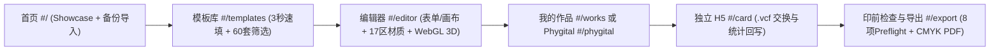

# 一番星 · 制作人名片设计平台 PRD

## 0. 文档信息

| 字段 | 内容 |
|------|------|
| **产品名称** | 一番星 · 制作人名片设计平台（ICHIBANBOSHI） |
| **文档版本** | v1.0（正式版全量同步） |
| **更新日期** | 2026-11-27 |
| **当前状态** | 正式版 `v1.0` 已交付上线（React 19 纯本地工作台 + 60 套通用多风格模板 + WebGL PBR 真实材质 + GitHub Pages & Figma UI 已同步） |
| **在线预览地址** | `https://auluscaelius.github.io/ichibanboshi-meishi/`（静态原型归档 `/prototype/`） |
| **Figma 设计稿** | `https://www.figma.com/design/mer2asPSDgBDXqSGC0OJdv`（含 00 设计规范与组件库 + 01–07 全量可编辑 UI） |
| **设计参考基准** | `https://gakuen.idolmaster-official.jp/`（仅参考视觉风格与设计语言，平台内置不含任何官方 IP 素材） |
| **版本演进记录** | `v0.2` 补全视觉规范与 Design Tokens；`v0.3` 完善「制作人Producer / 〇〇担当」预设集；`v0.4` 移除 WebGL/2D 人工扫光并加入全可编辑区域自由材质与前端 CMYK PDF 导出；**`v1.0` 彻底移除 `app/` 后端模块与根目录 `README.md`，于 `web/` 目录重构为 React 19 + TypeScript + Vite 8 + Zustand + Tailwind CSS v4 + Three.js 纯本地工程，保留 60 套（`G01`–`G60`）六大通用美学风格模板，全量对齐 PRD 双工作区视觉体系、IndexedDB 自动持久化、`.ichiban-*.json` 导入续作与 Figma 可编辑 UI 文件** |

---

## 1. 产品定位

「一番星（ICHIBANBOSHI）」是一款面向**偶像延伸文化同好（如偶像类游戏制作人 / 动漫与地偶爱好者）及独立插画师、设计师、创意开发者**的**纯本地离线优先（100% Local-First）**名片设计、物理材质审样与印前制作平台。核心使用场景覆盖 Only 展、漫展、Live 会场、地偶特典会、同好聚会以及日常设计交流名刺交换。

核心痛点在于：传统通用名片工具缺乏「选模板阶段即呈现真实成品感」的实时预填体验，且普遍缺少印前物理辅助线、CMYK / K100 专色黑版导出、独立特种纸+局部工艺 WebGL 三维校验与免后端双栖 H5 名片联动。「一番星」采用**零账号、零后端、纯浏览器端工程化架构**：

1. **信息预填实时渲染**：在模板库输入姓名/职位/事务所（内置 13 组担当快捷填充），即刻把 60 套通用模板切换为你的专属成品预览。
2. **双模式与 17 区域自由材质编辑器**：极简表单与自由画布双模式随时切换；支持正反面独立更换 6 种特种纸基底，并为 17 个可编辑区域独立赋予 9 种物理表面工艺。
3. **Three.js WebGL PBR 真实材质预览**：采用 `MeshStandardMaterial` 程序化生成纸张纤维高度图与云母光泽噪声、实体卡片厚度挤出倒角及三组受光微粒子环境，**彻底去除虚假人工扫光/斜光带**，所见即实物质感。
4. **前端原生 CMYK 印刷导出与双栖 H5**：内置 8 项 Preflight 质检规则、原生 DeviceCMYK PDF 1.4 / K100 专色黑版生成器，并支持纯前端 Base64url（`?slug=...&d=...`）生成自带 UTF-8 二维码与 `.vcf` 通讯录交换的移动端 H5 电子名刺页。
5. **纯本地持久化与跨设备续作**：通过 `IndexedDB`（`localStorage` 镜像兜底）自动保存全部方案、插画与自定义改版模板，并支持 `.ichiban-backup.json`、`.ichiban-card.json` 与 `.ichiban-template.json` 文件导入续作。

### 1.1 设计风格定位

平台视觉借鉴参考站的「**学园 × 舞台 × 现代装饰艺术**」明快能量感，同时依据页面职责实施**双工作模式分流**：

- **展示型页面（Showcase：`#/`、`#/templates`、`#/works`）**：以纯净白底 `#FFFFFF` 配高饱和落日橙渐变 `#FF7600 → #F39800` 建立主视觉；采用不对称「叶片角」圆角（`0 24px 0 24px` / `0 32px 0 32px`）、轻量玻璃态面板（`backdrop-filter: blur(10px–20px)`）、Art Deco 对称线条、巨型 `Poppins` 英文背景描边字、双语叠排导航，以及首页左侧富有舞台仪式感的竖排衬线口号（`为你的制作人之名，点亮一番星`）。
- **生产力工作区（Focus Workspace：`#/editor`、`#/phygital`、`#/export`）与 H5 页（`#/card`）**：隐藏大面积橙色展示头图与全局 Showcase Header/Footer，主背景降级为高对比冷静工作灰 `#F0F0F0` 配 `#FFFFFF` 功能面板与 `64px` 紧凑顶栏（`#/card` 为 `60px` 轻量顶栏），确保色彩判断与高频编辑零干扰。
- **合规材质与素材政策**：平台内置界面及 60 套通用模板**不包含任何官方 IP 商标文字、游戏截图、角色立绘或官方 LOGO**；用户可在编辑器「立绘 / 徽章」面板自行上传本地 PNG/JPG/SVG 素材用于个人同人制作，素材仅存于浏览器本地 `IndexedDB` 及用户自行导出的 JSON 备份文件中。

---

## 2. 目标用户画像

| 画像 | 基本背景 | 核心目标 | 现有痛点 | 依赖的关键功能 |
|------|----------|----------|----------|----------------|
| **偶像游戏玩家「小星」** | 22 岁，大学生，常参加 Only 展和 Live 应援 | 制作带有个人担当称呼（如 `花海咲季担当 / 初星学園`）与专属点缀色的制作人名刺 | 选模板时只能看到假字；不会精细排版与配色 | 信息预填实时渲染、13 组担当速填与色系筛点、极简表单、WebGL 3D 预览 |
| **动漫 / 视觉同好「千夏」** | 19 岁，动漫企划粉、Cosplayer | 为不同推与活动场景保存多套风格名片，并附上多个 SNS 账号与自定义立绘徽章 | 账号过多导致排版溢出；看不到珠光/烫金实物效果；上传插画刷新易丢 | Auto-Layout 自动缩字、本地立绘上传裁切、60 套六风格模板、自定义模板保存 |
| **地偶爱好者「阿澄」** | 25 岁，上班族，常去 Livehouse 参加特典会与同担交流 | 实体名片扫码可随时打开新版电子名刺与保存 `.vcf`，印前不踩坑 | 旧名片联系方式过时；不熟悉 3mm 出血、CMYK 与专色制版规范 | Phygital 双栖、`?d=` 无后端分享链接、8 项 Preflight 质检、CMYK PDF 与 K100 专色导出 |
| **独立创作者「林栖」** | 27 岁，独立插画师 / UI 设计师 | 快速挑选极简/社论/暗夜/瑞士风格通用模板定制个人名片，并用 Figma 二次调优或跨设备备份 | 多数名片站强绑定账号收费，无法离线保留工程与修改后模板 | 纯本地 `IndexedDB` + `.ichiban-backup.json` 导入续作、自由画布与 17 区域工艺、Figma 同步设计稿 |

---

## 3. 功能列表与核心流程

| 优先级 | 功能模块 | 实际实现要点（对应 `web/src/`） |
|--------|----------|----------------------------------|
| P0 | **60 套通用多风格模板库** | `G01`–`G60` 涵盖 `极简留白 minimal`、`现代几何 modern`、`杂志社论 editorial`、`暗夜先锋 obsidian`、`柔和渐变 pastel`、`秩序商务 swiss` 六大风格；支持风格/收藏/本地保存、版式（横/竖/方/单/双面）、13 组色系 HSL 感知圆点、工艺、关键词与排序筛选 |
| P0 | **信息预填实时渲染** | 模板库顶部支持输入 P 名、担当/职衔（带 13 人预设下拉）、事务所（`初星学園` / `765プロダクション` 快捷芯片），配合带 `--shadow-hard-blue` 强调的「预览效果」开关，实时替换网格中所有模板预览图并保留输入状态 |
| P0 | **双模式编辑器（极简表单 / 自由画布）** | 表单模式支持结构化字段、每字段独立材质选择与「点击卡片元素定位赋材质」；画布模式支持文本/贴纸/矩形/圆形/二维码/本地图片添加、拖拽位置宽高、层级显隐与锁定；内置 25 步撤销/重做栈（`undoStack` / `redoStack`） |
| P0 | **正反面切换与多规格圆角** | 支持 `正面` / `背面` 切换与 `单面 1` / `双面 2` 配置；内置 6 种物理规格（`cn 90×54`、`jp 91×55`、`eu 85×55`、`us 89×51`、`sq54 54×54`、`sq65 65×65`）及 `直角 / 3mm / 5mm` 裁切圆角；提供出血线/裁切线/安全区可视化开关 |
| P0 | **全可编辑区域自由材质与双面特种纸** | 开放 **17 个可编辑区域**（`frontBg`、`decor`、`name`、`enName`、`title`、`company`、`codeTag`、`eventTag`、`x`、`weibo`、`bilibili`、`xhs`、`website`、`motto`、`backBg`、`backTitle`、`qr`）独立配置 **9 种表面工艺**（原纸直印 / 缎面烫金 / 哑光烫银 / 赤铜烫印 / 击凸浮雕 / 活字压凹 / 立体厚墨 UV / 丝绒触感膜 / 拉丝金属）；支持正反面独立选择 **6 种特种纸基底**（哑光铜版纸 / 手工棉纸 / 云母珠光纸 / 深邃黑卡 / 越前和纸 / 磨砂半透 PVC） |
| P0 | **WebGL PBR 真实材质 3D 审样** | `preview3d.ts` 基于 Three.js `MeshStandardMaterial` + 程序化纸张纤维噪点生成粗糙度/金属度/凹凸贴图、按 `cornerMm` 与材质深度挤出真实三维倒角；提供右侧 `190px` 紧凑预览窗与全屏审样弹窗（正面/背面/侧面厚度/微距 4 机位、柔光影棚/舞台聚光/学园窗光 3 环境、受光角度与自动旋转），展开弹窗时自动暂停侧栏 RAF；**无虚假人工扫光** |
| P0 | **本地容灾与 JSON 导入导出续作** | `idb.ts` + `useStudioStore.ts` 通过 `IndexedDB`（`ichiban_local_studio_v2`）自动保存方案、插画、自定义模板、制作人档案与收藏（`localStorage` 镜像兜底）；`BackupModal.tsx` 支持导出/合并/覆盖导入 `.ichiban-backup.json`、`.ichiban-card.json`、`.ichiban-template.json` |
| P1 | **Auto-Layout 自动排版引擎** | `renderCardHtml.ts` 空字段自动隐去不占行；P 名等核心文字触发 `.is-long-name` 与双行安全限宽字号微调，避免溢出与遮挡 |
| P1 | **Preflight 8 项质检与一键修复** | `preflight.ts` 自动检查图像 DPI、3mm 安全区越界、≥6pt 最小字号、≥0.25pt 极细线宽、CMYK 色域、SIL OFL 字体授权、正面必填 P 名与 K100 单色黑防重影；支持一键自动修复与「定位修复 →」跳回编辑器具体图层 |
| P1 | **原生前端 PDF 1.4 与专色输出** | `printExport.ts` 前端原生封装含出血线与套准裁切标的 `DeviceCMYK` / `DeviceRGB` 多页 `.pdf`（300 / 600 DPI、0 / 2 / 3mm 出血、自动 K100 纯黑文字分离），支持额外导出 `DeviceGray` 专色黑版 PDF 附页与独立 `.svg` 专色版、双面 `.png`/`.jpg` 自动打包 `.zip` 及 `.txt` 印刷规格单 |
| P1 | **Phygital 双栖与独立 H5 名刺** | `shareCodec.ts` 将设计配置、字段、正反面纸基、区域工艺与 H5 布局编码为 Base64url 参数 `?slug=...&d=...`；`qrcode.ts` 生成高清 UTF-8 二维码；`#/card` 支持实体正反对照弹窗、SNS 复制、下载 `{safeName}-meishi.vcf` 通讯录及 PV / 保存计数本地回写 |
| P2 | **「我的作品」与自定义模板管理** | `#/works` 聚合统计已存名刺数、本地模板数、H5 PV 与 `.vcf` 保存数，支持方案搜索/排序、正反预览、重命名、复制、删除及「修改保存的模板」管理与再编辑 |

### 3.1 核心用户流程



---

## 4. 信息架构与路由清单

| 页面名称 | HashRouter 路径 | 源码文件 | 壳模式 | 核心职责 |
|----------|-----------------|----------|--------|----------|
| 首页落地页 | `#/` | `web/src/pages/HomePage.tsx` | Showcase（Header + Footer） | 竖排标语 Hero、3 卡悬浮展示、导入工程快捷入口、Features / Why / Pick Up / Sunburst CTA |
| 模板库 | `#/templates` | `web/src/pages/TemplatesPage.tsx` | Showcase（Header + Footer） | 60+ 模板总览、3 秒预填玻璃面板（13 担当组合框 + 蓝影预览开关）、2 行吸顶多维筛选、双面悬停翻转与放大弹窗 |
| 我的作品管理台 | `#/works` | `web/src/pages/WorksPage.tsx` | Showcase（Header + Footer） | 顶部汇总统计、制作人档案入口、「名刺方案 / 修改保存的模板」双标签切换、重命名/复制/导出 JSON/直达编辑或 H5 |
| 名片编辑器 | `#/editor` | `web/src/pages/EditorPage.tsx` | Focus 工作台（64px 顶栏，`#F0F0F0`） | 撤销重做、极简表单/自由画布切换、立绘上传、17 区域独立工艺、6 种纸基横条、右侧 WebGL 3D 窗与展开模态框、保存自定义模板 |
| Phygital 双栖视图 | `#/phygital` | `web/src/pages/PhygitalPage.tsx` | Focus 工作台（64px 顶栏，`#F0F0F0`） | 实体背面二维码联动 + H5 布局/简介/SNS 开关 + `375px` 手机样机预览 + 短链与动态 QR SVG/PNG 下载 + PV 统计 |
| 印前检查与导出 | `#/export` | `web/src/pages/ExportPage.tsx` | Focus 工作台（64px 顶栏，`#F0F0F0`） | 左 7 栏 8 项 Preflight 清单与一键修复，右 5 栏三标签出血/专色黑版预览、参数芯片组与 PDF/SVG/PNG/JPG 导出 |
| 独立 H5 电子名刺页 | `#/card` | `web/src/pages/DigitalCardPage.tsx` | 独立 H5 轻壳（60px 顶栏，无 Footer） | 解析 `?slug=` / `?d=` 渲染移动端卡片、实体正反对照弹窗、SNS 一键复制、`.vcf` 联系人下载与 PV/保存数回写 |

> **历史原型归档说明**：`prototype/*.html` 作为早期的静态多页原型保留于 `prototype/`（随 GitHub Pages 发布于 `/prototype/`），与正式版 React 单页应用并存。

### 4.1 全局导航命名规范（Showcase Header & Footer）

顶部 Showcase Header 固定高 `80px`，采用双语叠排导航项与制作人名籍/备份动作胶囊：

| 路由 / 动作 | 中文主标签 | 英文副标签 | 展示位置 |
|-------------|------------|------------|----------|
| `#/templates` | 模板库 | `TEMPLATES` | 全局 Header 导航栏 & Footer |
| `#/works` | 我的作品 | `WORKS` | 全局 Header 导航栏 & Footer |
| `#/` `#features` 锚点 | 功能介绍 | `FEATURES` | 全局 Header 导航栏 |
| `#/` `#about` 锚点 | 关于 | `ABOUT` | 全局 Header 导航栏 |
| `BackupModal` | 导入 / 备份 | — | 全局 Header 右侧（显示已存方案/模板提示）& Footer |
| `ProfileModal` | 制作人名籍胶囊 | — | 全局 Header 右侧（带担当色圆点，默认显示 `制作人报到` 或昵称） |
| `#/templates` | 免费开始设计 | — | 全局 Header 最右侧紧凑 CTA 按钮（`44px` 叶片角） |

---

## 5. 视觉感受与 Design Tokens

### 5.1 设计关键词

**明亮元气 · 学园青春 · 舞台闪耀 · 精致装饰艺术 · 留白呼吸感 · 「一番星 ✦」**

### 5.2 核心视觉法则

1. **纯白底 + 活力橙金渐变**：Showcase 展示页以纯白 `#FFFFFF` 建立通透留白，以 `#FF7600 → #F39800` 渐变承载 Hero 与焦 点按钮。
2. **不对称「叶片角」圆角**：按钮 `--radius-leaf-btn: 0 24px 0 24px`（紧凑按钮 `0 18px 0 18px`），卡片交替 `0 32px 0 32px` 与 `32px 0 32px 0`，输入框 `0 12px 0 12px`。
3. **超大英文背景字**：`Poppins 600`，在橙色背景上采用 `20%` 白色，在浅色背景上采用 `1px #F39800` 描边填充透明。
4. **斜体渐变裁切章节标题**：`32px` 斜体、`letter-spacing: 0.3em`、渐变文字裁切配合品牌星标 `✦`。
5. **双层框 `MORE` 按钮**：外层 `1px solid #F39800` + 内缩边距 + 内层渐变填充，`Poppins 600` 全大写 `MORE →`。
6. **轻盈玻璃拟态与无扫光真实材质**：Header、功能卡片、Toast 与预填面板采用高透玻璃态配 `blur(10px–20px)`；全站去除人工斜扫光光带，仅保留真实物理材质纹理与微粒子照明氛围。
7. **工具页视觉降级**：进入 `#/editor`、`#/phygital`、`#/export` 后切换至 `#F0F0F0` 浅灰底色 + `64px` 顶栏，减少环境色彩对校色的干扰。

### 5.3 核心 Design Tokens 与 13 组应援色预设

详见文档末尾 **`附录 A：CSS 变量`**。此外，在预填面板与个人名籍预设中内置 13 组偶像应援色圆点（用于 `担当` 速填及模板库 HSL 感知色系筛选 `matchesIdolColorFamily`）：

| 预设偶像 | 色值 | 浅色安全描边 | 预设偶像 | 色值 | 浅色安全描边 |
|----------|------|--------------|----------|------|--------------|
| 花海咲季 | `#E30F25` | 否 | 篠澤広 | `#00AFCC` | 否 |
| 月村手毬 | `#0C7BBB` | 否 | 姫崎莉波 | `#F6ADC6` | 是 (`1px #BFBFBF`) |
| 藤田ことね | `#F8C112` | 否 | 花海佑芽 | `#EA533A` | 否 |
| 有村麻央 | `#7F1184` | 否 | 秦谷美鈴 | `#7A99CF` | 否 |
| 葛城リーリヤ | `#EAFDFF` | 是 (`1px #BFBFBF`) | 十王星南 | `#F6AE54` | 否 |
| 倉本千奈 | `#F68B1F` | 否 | 雨夜燕 | `#7B68EE` | 否 |
| 紫雲清夏 | `#7CFC00` | 是 (`1px #BFBFBF`) | — | — | — |

### 5.4 字体与可访问性

- **字体族**：`Poppins`（英文展示）、`Noto Sans SC`（中文主标题与正文）、`Noto Serif SC` / `Zen Antique Soft`（Hero 竖排衬线口号）、`M PLUS Rounded 1c`（徽章与统计数字）— 全部为 SIL Open Font License (OFL) 开源商用免费字体。
- **对比度红线**：白底小字橙色链接降明度使用 `--orange-700`（`#D95F00`）；禁止在橙色渐变底上直接排版小号深色正文；`:focus-visible` 呈现 `2px solid #4E93F2` 焦点外环；所有模态框（`.auth-modal*`）固定 `z-index: 2200` 视口居中呈现。

---

## 6. 六大通用多风格模板体系（`G01`–`G60`）

为提升通用适配性并规避角色特定绑定，正式版系统内置模板库提供 **60 套面向独立创作者与同好交流的通用模板**，均不包含特定偶像姓名或作品商标，按六大美学风格均分（每类 10 套）：

| 风格 ID 与名称 | 编号区间 | 典型色彩搭配 | 版式与装饰母题 | 推荐纸基与默认工艺 |
|----------------|----------|--------------|----------------|--------------------|
| `minimal` **极简留白** | `G01`–`G10` | 深石青 `#0F172A`、晨光橙 `#FF7600`、灰调 `#475569`、透明霜白 `#64748B` | 大面积留白、细十字校准线、方形锚框、无边框素笺 | 哑光铜版 / 手工棉纸 / 越前和纸 / 磨砂 PVC；活字压凹 / 击凸 / UV |
| `modern` **现代几何** | `G11`–`G20` | 亮橙 `#FF7600`、电蓝 `#2563EB`、紫罗兰 `#7C3AED`、洋红 `#E11D48` | 28% 主色分割块、斜角动能条、胶囊信息矩阵、双色视窗 | 哑光铜版 / 珠光纸 / 磨砂 PVC；立体厚墨 UV / 哑光烫银 / 缎面烫金 |
| `editorial` **杂志社论** | `G21`–`G30` | 刊头黑青 `#1E293B`、酒红 `#9F1239`、靛蓝 `#312E81`、墨绿 `#065F46` | 刊首衬线标头、双栏报刊网格、引文居中卡片、展录索引 | 越前和纸 / 手工棉纸 / 云母珠光纸；赤铜烫印 / 缎面烫金 / 压凹 |
| `obsidian` **暗夜先锋** | `G31`–`G40` | 通体黑底配琥珀金 `#F59E0B`、钛银 `#E2E8F0`、霓虹橙 `#FF7600`、翡翠 `#34D399` | 单体黑卡留白、夜航竖条、终端格线、微弧星轨线 | 深邃黑卡 `450gsm`；缎面烫金 / 哑光烫银 / 丝绒触感膜 / 拉丝金属 |
| `pastel` **柔和渐变** | `G41`–`G50` | 蜜桃粉 `#FB7185`、薄荷绿 `#14B8A6`、薰衣草 `#8B5CF6`、燕麦拿铁 `#A16207` | 柔角徽章、糖果胶囊、水彩晕染分栏、奶油方卡 | 云母珠光纸 / 哑光铜版 / 手工棉纸 / 越前和纸；击凸 / 烫银 / 玫瑰铜 |
| `swiss` **秩序商务** | `G51`–`G60` | 瑞士红 `#DC2626`、蓝图蓝 `#1D4ED8`、导视橙 `#FF7600`、黑白 `#111827` | 12 栏严格对齐、表格式字段索引、公共导视标牌、四象限模块 | 哑光铜版 / 手工棉纸 / 磨砂 PVC；原纸直印 / 压凹 / 拉丝 / 烫银 |

---

## 7. 页面详细说明

### 7.1 全局 Showcase Header & Footer

- **SiteHeader**：固定顶部 `80px`，滚动超 `80px` 出现橙渐变底边；左置「一番星 ✦ / ICHIBANBOSHI」，中间包含「模板库」「我的作品」「功能介绍」「关于」4 组双语叠排导航，右置「导入 / 备份」按钮、制作人名籍胶囊与「免费开始设计」主 CTA。
- **SiteFooter**：全幅橙色渐变配白色高透 `1200px` 4 栏导航卡及巨型白色 `ICHIBANBOSHI` 背景字；底部标识 `© 2026 一番星 ICHIBANBOSHI · 同人制作 · Fan-made Tool` 与纯本地存储声明。

### 7.2 首页落地页（`#/`）

1. **Hero 首屏区**：橙色渐变配噪点与光斑，左侧竖排衬线 `为你的制作人之名，点亮一番星`，右侧 3 张随光标视差倾斜的名片（使用 `G01`、`G31`、`G41` 搭配示例身份）；操作区提供「免费开始设计」、「浏览模板库 →」、「导入上次保存工程」与「继续编辑当前名刺 →」快捷入口。
2. **功能亮点（FEATURES）**：4 张交替叶片角玻璃卡展示「01 信息预填实时渲染」「02 双模式编辑器」「03 真实 3D 物理材质预览」「04 印刷级专业导出」。
3. **核心差异（WHY ICHIBANBOSHI）**：3 行白色玻璃图文卡，分别演示 Auto-Layout 超长文本自适应 vs 溢出对比、Phygital 实体背面二维码到手机 H5 `.vcf` 映射、Preflight 质检拦截与一键修复。
4. **精选模板（PICK UP）**：支持按六大风格筛选 8 套精选（`G02`、`G11`、`G21`、`G31`、`G41`、`G51`、`G14`、`G34`），横向滑动卡片点击直达编辑器。
5. **Art Deco 日芒 CTA 带**：浅暖底日芒放射线背景与「今天，就交出你的第一张制作人名片」主 CTA。

### 7.3 模板库（`#/templates`）

1. **页头标题带**：`首页 / 模板库`，主标 `模板库 ✦`，右上展示模板总数徽章（`共 60+ 套模板`）与 `导入模板 .json` 按钮。
2. **信息预填实时渲染面板**：输入 `P 名`（默认占位 `制作人Producer`）、`职位/担当`（13 人担当组合框 `〇〇担当`）与 `事务所/组织`（快捷填充 `初星学園` / `765プロダクション`），右侧设置「预览效果」开关（`role="switch"` + 蓝色硬投影 `--shadow-hard-blue`）与清空按钮。支持 `?state=long`（超长文本测试状态）与 `?state=empty`（空结果展示）URL 状态参数。
3. **吸顶两行筛选栏**：第一行风格 Chip（全部 / 六大通用风格 / 本地保存 / 收藏）、匹配数统计及排序（热门优先 / 最新发布）；第二行版式（全部 / 横版 / 竖版 / 方形 / 单面 / 双面）、13 组应援色圆点（基于 HSL 感知色系距离匹配同色系通用模板，确保 13 色均有丰富命中）、工艺筛选（全工艺 / 烫金银铜 / 局部 UV / 凹凸 / 原纸）、关键词搜索与「清除筛选」。
4. **4 列模板网格与弹窗**：每卡带 `#F0F0F0` 舞台衬底、正反悬停翻转（双面模板自动展示背面）、`NEW / HOT / 烫金` 角标、收藏爱心与「使用此模板」主动作；支持打开双面放大对比弹窗及将本地保存的自定义模板导出为 `.ichiban-template.json`。

### 7.4 名片编辑器（`#/editor`）

1. **64px 紧凑顶栏**：左区返回模板库、当前方案标题编辑、撤销/重做按钮（`Ctrl/Cmd+Z`，25 步栈）与自动保存时间戳；中区切换 `极简表单` / `自由画布`；右区「保存当前模板 / 存为新模板」、「备份」、跳转「Phygital 双栖」与主 CTA「印前检查与导出 →」。
2. **360px 左侧抽屉**：
   - **表单模式**：标签切换「基础信息 / 社交账号 / 立绘徽章 / 卡底区域」；每个输入字段顶部附带该区域专属工艺下拉选择，支持 13 人担当预设、事务所示范快捷标签以及立绘 PNG/JPG 上传与裁切调整（`fit` / 缩放 / X·Y 偏移 / 不透明度 / 圆角 / 独立工艺）。
   - **画布模式**：左侧 `64px` 窄轨抽屉切换「模板风格 / 添加文字 / 预设装饰 / 上传图片 / 几何图形 / 图层列表」，支持添加文字、贴纸徽章、矩形、圆形与二维码占位到正/反面自由画布。
3. **自适应中央画布 + 56px 底部材质条**：
   - 顶浮工具条：正/反面切换、单/双面切换、6 规格下拉、圆角（直角 / `3mm` / `5mm`）、出血/裁切/安全区引导线开关、主题主色拾色器。
   - 中央 `CardFaceView` 支持直接点击卡面上任意 `[data-region]` 元素高亮聚焦并在右栏即时赋材质；底部左右悬浮尺寸/纸基状态胶囊与缩放切换（`85% / 100% / 115%`）。
   - 底部 `56px` 横条：左侧 6 种当前面纸张基底色板，右侧 9 种表面工艺快捷胶囊（`1440px` 宽下完整换行不溢出）。
4. **300px 右侧审样与材质工作台**：
   - 顶部嵌入 `190px` Three.js WebGL PBR 真实材质实时预览窗与 `展开 3D` 按钮（打开 360° 大弹窗并暂停侧栏渲染以节省 GPU）。
   - 中部为 **17 个可编辑区域**切换芯片与 9 种工艺详卡（展示 Metallic/Roughness 物理参数）；自由画布选中自定义图层时则就地编辑图层坐标/尺寸/旋转/字号/透明/工艺。
   - 底部快捷按钮：「另存副本」与「印前检查 →」。

### 7.5 Phygital 双栖（`#/phygital`）

- 64px 顶栏 + 三栏同步工作台 + 底部动态短链与统计栏：
  - 左栏展示实体名片背面二维码预览、3 套 H5 版式切换（`卡片式 card` / `海报式 poster` / `极简列表 list`）、H5 简介文本与 5 项 SNS 显隐开关（X、微博、B站 UID、小红书、个人网址）。
  - 右栏 `375px` 等比手机框实时预览当前 H5 页面。
  - 底栏配置短链别名 `slug/`、复制带完整 Base64url 载荷 `?slug=...&d=...` 的免服务器分享链接、**打开 H5 实机页 ↗**、下载高清 QR `.svg`/`.png`，并展示实时累加访问 PV、通讯录保存数与 7 日折线图。

### 7.6 印前检查与导出（`#/export`）

- **左 7 栏 Preflight 质检清单**：检测 8 项规则（`dpi` 分辨率、`safezone` 3mm 安全区、`fontsize` 最小 ≥6pt 字号、`stroke` 极细线宽、`color` CMYK 映射、`font` SIL OFL 授权、`required` 核心字段、`richblack` K100 单色黑），支持「一键自动修复全部建议项」与单条「定位修复 →」跳回编辑器并自动定位对应表单/画布图层。
- **右 5 栏导出配置**：三标签实时预览框（`正面成品 / 背面成品 / 专色黑版`）；支持格式（PDF / SVG / PNG / JPG）、色彩模式（CMYK / RGB）、精度（300 / 600 DPI）、出血（3mm / 2mm / 0mm）、文字处理（全部转曲 / 内嵌字体）、裁切套准标记、分离 K100 专色黑版与小字 K100 保护开关；生成后可下载主印刷文件、独立 `_专色版.svg` 与 `_印刷规格单.txt`。

### 7.7 我的作品（`#/works`）与独立 H5 页（`#/card`）

- **Works（`#/works`）**：展示已存名刺数、本地模板数、H5 累计 PV、通讯录保存总数与制作人档案卡片；提供「名刺方案」与「修改保存的模板」双标签页切换、搜索与最近/热度排序、正反面预览、重命名弹窗、复制副本、导出单卡/模板 JSON 与备份管理弹窗。
- **Digital Card（`#/card`）**：独立零冗余导航移动端实机页，优先解码 URL `?d=` Base64url 载荷（无参数时匹配 `?slug=` 或当前工程），展示顶部快捷「查看实体名刺」正反面对照弹窗与「我也要制作 ✦」跳转按钮、一键复制各 SNS、点击导出标准 vCard 3.0 文件 `${safeName}-meishi.vcf` 并实时递增对应作品统计。

---

## 8. 示例数据、预设与 60 套模板目录

### 8.1 名片用户信息示例集

| 场景状态 | P 名 / 姓名 | 职位 / 担当 | 公司 / 事务所 | SNS 示例 |
|----------|-------------|-------------|---------------|----------|
| **默认占位** | `制作人Producer` | `〇〇担当` | `初星学園` | `X @hatsuboshi_p` |
| **激活标准** | `制作人Producer` | `花海咲季担当` | `初星学園` | `X @hatsuboshi_p / 微博 @制作人Producer / B站 UID 12345678` |
| **765 变体** | `制作人Producer` | `天海春香担当` | `765プロダクション` | `X @hatsuboshi_p / ichiban.star` |
| **超长边界测试** | `制作人Producer（初星学園プロデューサー科 首席）` | `花海咲季・花海佑芽 姉妹担当` | `765プロダクション × 初星学園 合同プロデュース部` | 自动缩字与双行截断不破版 |

### 8.2 60 套通用多风格模板清单（`G01`–`G60`）

1. **极简留白 `minimal`（`G01`–`G10`）**：`G01 留白画室`（横/棉纸/压凹）、`G02 晨光极简`（横/哑粉/UV）、`G03 竖排素笺`（竖/棉纸/压凸）、`G04 纸白细格`（横/和纸/压凹）、`G05 方寸留白`（方/棉纸/压凸）、`G06 灰调素描`（横/哑粉/原纸）、`G07 立轴极简`（竖/珠光/烫银）、`G08 浅杏微光`（横/和纸/赤铜）、`G09 方卡画框`（方/哑粉/UV）、`G10 透明素卡`（横/磨砂PVC/烫银）。
2. **现代几何 `modern`（`G11`–`G20`）**：`G11 几何分割`（横/UV）、`G12 斜角动能`（横/珠光/烫银）、`G13 竖排几何`（竖/压凸）、`G14 霓虹框格`（横/UV）、`G15 方块序列`（方/UV）、`G16 翠竹建筑`（横/棉纸/压凹）、`G17 竖版色带`（竖/珠光/拉丝）、`G18 暖橙胶囊`（横/压凸）、`G19 方卡斜切`（方/磨砂PVC/UV）、`G20 双色视窗`（横/哑粉/烫金）。
3. **杂志社论 `editorial`（`G21`–`G30`）**：`G21 刊首社论`、`G22 画册目录`、`G23 双栏刊物`、`G24 方寸书签`、`G25 罗马章节`、`G26 竖栏引文`、`G27 秋叶画报`、`G28 灰框纪实`、`G29 立式书页`、`G30 画刊方帖`。
4. **暗夜先锋 `obsidian`（`G31`–`G40`，450gsm 深邃黑卡）**：`G31 曜石金箔`、`G32 冷银锋芒`、`G33 竖版夜航`、`G34 紫电暗夜`、`G35 黑芯方卡`、`G36 拉丝黑钛`、`G37 竖排天鹅绒`、`G38 深渊翠光`、`G39 铜锈古墨`、`G40 极夜星轨`。
5. **柔和渐变 `pastel`（`G41`–`G50`）**：`G41 朝露蜜桃`、`G42 薄荷晴风`、`G43 竖版熏衣草`、`G44 奶油方卡`、`G45 晴空淡蓝`、`G46 樱雾渐层`、`G47 杏橘日落`、`G48 苔藓微绿`、`G49 珍珠云母`、`G50 奶茶素雅`。
6. **秩序商务 `swiss`（`G51`–`G60`）**：`G51 瑞士网格`、`G52 精密蓝图`、`G53 竖版目录`、`G54 正方标牌`、`G55 双色年鉴`、`G56 横栏标签`、`G57 竖立简报`、`G58 标准方格`、`G59 极简工牌`、`G60 经典黑白`。

### 8.3 首页全量核心文案清单

| 所属区块 | 元素位置 | 现行正式版文案 |
|----------|----------|----------------|
| **Hero** | 左侧竖排文案 | `为你的制作人之名，点亮一番星` |
| **Hero** | H1 主标题 | `从挑选「成品」开始的制作人名片设计平台` |
| **Hero** | 副文案 | `填上你的资料，60 套通用多风格名刺模板即刻变为专属成品。支持自由插画裁剪、全可编辑区域材质、WebGL 实体 3D 预览、CMYK 印刷导出与本地文件导入续作。` |
| **Hero** | 主/次/备份按钮 | `免费开始设计` / `浏览模板库 →` / `导入上次保存工程` |
| **Features** | 章节标题 / 背景字 | `功能亮点 ✦` / `Features`（卡片：`信息预填实时渲染`、`双模式编辑器`、`真实 3D 物理材质预览`、`印刷级专业导出`） |
| **Why** | 章节标题 / 背景字 | `核心差异 ✦` / `Why Ichibanboshi`（三行：`Auto-Layout 智能自动排版`、`Phygital 实体 + 数字双栖名片`、`Preflight 专业印前质检`） |
| **Pick Up** | 章节标题 / 背景字 | `精选模板 ✦` / `Pick Up` + 六风格过滤芯片 + `查看全部模板 MORE →` |
| **CTA 带** | 主文案 / 按钮 | `今天，就交出你的第一张制作人名片` / `免费开始设计 ✦` |
| **Footer** | 底部标识 | `© 2026 一番星 ICHIBANBOSHI · 同人制作 · Fan-made Tool` / `纯本地存储 · 随时导入导出延续创作` |

---

## 9. 名片规格与印前标准

| 规格 ID | 规格名称 | 成品净尺寸 | 含每边 3mm 出血 | 安全区（内缩 3mm） | 可选圆角 | 导出分辨率 |
|---------|----------|------------|-----------------|--------------------|----------|------------|
| `cn` | **国内标准名片** | `90 × 54 mm` | `96 × 60 mm` | `84 × 48 mm` | 直角 / `3mm` / `5mm` | `300 / 600 DPI` |
| `jp` | **日系四号名片** | `91 × 55 mm` | `97 × 61 mm` | `85 × 49 mm` | 直角 / `3mm` / `5mm` | `300 / 600 DPI` |
| `eu` | **欧标商务名片** | `85 × 55 mm` | `91 × 61 mm` | `79 × 49 mm` | 直角 / `3mm` / `5mm` | `300 / 600 DPI` |
| `us` | **美标名片** | `89 × 51 mm` | `95 × 57 mm` | `83 × 45 mm` | 直角 / `3mm` / `5mm` | `300 / 600 DPI` |
| `sq54` | **紧凑方形卡** | `54 × 54 mm` | `60 × 60 mm` | `48 × 48 mm` | 直角 / `3mm` / `5mm` | `300 / 600 DPI` |
| `sq65` | **展示方形卡** | `65 × 65 mm` | `71 × 71 mm` | `59 × 59 mm` | 直角 / `3mm` / `5mm` | `300 / 600 DPI` |

> **出血联动规范**：导出设置页可在 `0mm / 2mm / 3mm` 间切换出血边距（默认 `3mm`），红虚线出血标与印刷尺寸实时重算，所有核心文字、LOGO 与二维码均要求留在内缩 `3mm` 安全区内。

---

## 10. 正式版技术架构与本地持久化规范

为确保纯离线可用性与长期可维护性，`v1.0` 已彻底移除 `app/` 后端模块与根目录 `README.md`，所有正式版代码组织于 `web/` 目录：

- **技术栈**：`React 19` + `TypeScript 5.8` + `Vite 8` + `Zustand 5` + `Tailwind CSS v4` + `Three.js 0.187` + `Lucide React` + `Vitest 5`。
- **核心模块划分**：
  - `web/src/types/card.ts`：完整强类型契约（6 种风格、6 种特种纸、9 种表面工艺、17 个可编辑区域、`StandeeConfig`、`CanvasElement`、`H5Config`、`CardProject`）。
  - `web/src/data/templates.ts`：60 套通用模板种子（`G01`–`G60`）、13 组应援色/担当预设、纸基与工艺元数据。
  - `web/src/storage/idb.ts` & `backup.ts`：`IndexedDB`（`ichiban_local_studio_v2`）异步持久化 + `localStorage` 镜像兜底，以及全量工作台（`ichiban-workspace-backup`）、单卡工程（`ichiban-card`）、单模板（`ichiban-template`）三类 JSON 协议序列化与清理校验（`version: 2`）。
  - `web/src/stores/useStudioStore.ts`：全局状态中心（`works`、`customTemplates`、`favorites`、`profile`、`prefill`、`activeProject`、25 步撤销/重做栈、`120ms` 持久化防抖与统计累加）。
  - `web/src/engines/`：`renderCardHtml.ts`（DOM 与打印/3D 共享的 HTML + SVG 渲染器与 Auto-Layout 测量）、`preview3d.ts`（Three.js PBR 真实纸纹与工艺掩膜引擎）、`preflight.ts`（8 项印前质检与一键修复）、`printExport.ts`（CMYK/RGB PDF 1.4、K100 专色与 PK ZIP 生成器）、`qrcode.ts`（原生 UTF-8 QR 编码）与 `shareCodec.ts`（紧凑 Base64url 分享编解码）。
- **自动化验证与交付**：`web/src/__tests__/engines.test.ts` 覆盖 60 套模板无敏感词检测、QR/ShareCodec 往返、备份 JSON 往返、Preflight 自动修复与 CMYK PDF/ZIP 二进制校验；构建产物部署至 `gh-pages`，可编辑 UI 已同步至 Figma（`https://www.figma.com/design/mer2asPSDgBDXqSGC0OJdv`）。

---

## 11. 非功能需求

1. **视口与适配**：桌面端主力按 `1440px`（`1280px–1920px`）设计；`#/card` 针对移动端 `375px–410px` 竖屏体验独立优化。
2. **预填渲染性能**：全量 `60+` 套模板在输入预填文字或切换色系圆点时瞬间响应渲染，无网络请求延迟。
3. **3D 性能与功耗控制**：编辑器右侧缩略窗与全屏 3D 弹窗共享暂停信号（打开弹窗自动暂停侧栏 RAF）；未支持 WebGL 的环境允许以 2D 正反卡面继续编辑与导出。
4. **纯本地容量弹性**：高分辨率用户上传立绘插画优先完整保存在 `IndexedDB` 中，避免 `localStorage` `5MB` 配额溢出导致保存中断。
5. **字体加载**：使用 `display=swap` 按需加载开源字体，并在离线或导出 SVG 嵌入时优雅回退至系统无衬线/衬线字体族。

---

## 12. 素材与知识产权合规说明

1. **内置零 IP 风险原则**：平台界面、60 套通用模板（`G01`–`G60`）与内置示例均已通过自动化单元测试校验，不包含角色立绘、官方截图、游戏徽标或受版权限制的专有字体。
2. **个人素材本地流转**：用户在编辑器内上传的所有图片与插画仅在本地浏览器内存与 `IndexedDB` 中处理，导出时仅封装进入用户个人本地 PDF/备份 JSON，不经由任何平台服务器存储或分发。
3. **商用开源字体**：前端展示与导出支持字体（`Poppins`、`Noto Sans SC`、`Noto Serif SC`、`M PLUS Rounded 1c`、`Zen Antique Soft`、`JetBrains Mono`）均采用 SIL Open Font License (OFL) 或兼容开源许可。

---

## 13. UI 设计规范红线与视觉验收基线

1. **严禁**将展示型首页、模板库或作品管理台退化为暗黑主题（Dark Mode）或全站千篇一律的 `8px/12px` 对称圆角工具面板，必须保持明快白底 + 橙金渐变与叶片角造型。
2. **严禁**在 2D 卡面预览或 Three.js WebGL 场景中添加虚假的白色斜条人工扫光或动画反光遮罩；金属、UV、丝绒与压凹感必须通过 PBR 材质粗糙度/金属度/高度贴图真实表达。
3. **严禁**在高饱和橙色背景上直接排版 `≤ 14px` 的深色长正文（必须置于白色玻璃卡片或高对比度白色胶囊中）。
4. **模态框视口规范**：所有交互弹窗（`.auth-modal`）必须采用视口固定居中（`position: fixed; inset: 0; z-index: 2200`）并在 `1440×900` 下完整可见，不得被编辑器工作台流推出可视区。

---

## 附录 A：核心 CSS 变量（`web/src/styles/prd.css`）

```css
:root {
  /* 品牌核心色与渐变 */
  --orange-500: #FF7600;
  --amber-500: #F39800;
  --orange-700: #D95F00;
  --amber-100: #FFF3AE;
  --cream-50: #FFF7EC;
  --gradient-primary: linear-gradient(90deg, #FF7600 0%, #F39800 100%);
  --gradient-primary-rtl: linear-gradient(-90deg, #FF7600 0%, #F39800 100%);
  --gradient-shine: linear-gradient(90deg, #FF7600 0%, #F39800 50%, #FF7600 100%);

  /* 中性色 */
  --white: #FFFFFF;
  --gray-50: #F0F0F0;
  --gray-100: #E9E9E7;
  --gray-300: #BFBFBF;
  --gray-600: #535353;
  --ink: #333333;
  --black: #000000;

  /* 语义与强调色 */
  --color-success: #008969;
  --color-warning: #F8C112;
  --color-error: #E30F25;
  --color-info: #4E93F2;

  /* 13 组预设色系 */
  --tantou-saki: #E30F25;
  --tantou-temari: #0C7BBB;
  --tantou-kotone: #F8C112;
  --tantou-mao: #7F1184;
  --tantou-lilja: #EAFDFF;
  --tantou-china: #F68B1F;
  --tantou-sumika: #7CFC00;
  --tantou-hiro: #00AFCC;
  --tantou-rinami: #F6ADC6;
  --tantou-ume: #EA533A;
  --tantou-misuzu: #7A99CF;
  --tantou-sena: #F6AE54;
  --tantou-tsubame: #7B68EE;

  /* 玻璃拟态与阴影 */
  --glass-bg: rgba(255, 255, 255, 0.75);
  --glass-strong: rgba(255, 255, 255, 0.95);
  --blur-light: 10px;
  --blur-heavy: 20px;
  --shadow-card: 0 10px 30px rgba(51, 51, 51, 0.15);
  --shadow-float: 0 24px 48px rgba(51, 51, 51, 0.25);
  --shadow-hard-blue: 0 6px 0 #4E93F2;

  /* 字体与圆角 */
  --font-display-en: 'Poppins', sans-serif;
  --font-sans: 'Noto Sans SC', 'Poppins', sans-serif;
  --font-serif: 'Noto Serif SC', 'Zen Antique Soft', serif;
  --font-rounded: 'M PLUS Rounded 1c', 'Noto Sans SC', sans-serif;
  --radius-leaf-btn: 0 24px 0 24px;
  --radius-leaf-btn-sm: 0 18px 0 18px;
  --radius-leaf-card: 0 32px 0 32px;
  --radius-leaf-card-alt: 32px 0 32px 0;
  --radius-input: 0 12px 0 12px;
  --radius-pill: 999px;
}
```
