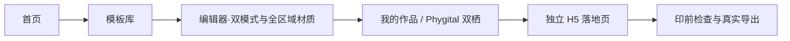

# 一番星 · 制作人名片设计平台 PRD


## 0. 文档信息

| 字段 | 内容 |
|------|------|
| **产品名称** | 一番星 · 制作人名片设计平台（ICHIBANBOSHI） |
| **文档版本** | v0.4 |
| **更新日期** | 2026-11-27 |
| **当前状态** | 高保真原型已同步（Round 1–3 + WebGL 真实材质） |
| **设计参考基准** | `https://gakuen.idolmaster-official.jp/`（仅参考视觉风格与设计语言） |
| **交付目标** | 同步当前 7 页可交互原型的完整能力与真实物理材质体系，规范全可编辑区域自由材质选择与无反光扫光的 WebGL 3D 预览 |
| **主要变更说明** | v0.2 补全设计风格定位、Design Tokens、页面级模块说明与原型指引；v0.3 将模板按学マス偶像/支援卡/性格重命名，示例数据统一为「制作人Producer / 〇〇担当 / 初星学園・765プロダクション」，用户画像聚焦偶像爱好者；**v0.4 同步当前已落地项目（新增「我的作品」多方案管理台 `/works`、独立 H5 电子名刺 `/card` 与 PV/vCard 实时统计回流、制作人登录弹窗、前端原生 PDF 1.4/PNG/JPG 与 K100 专色黑版导出、Three.js WebGL 真实厚度与肌理引擎），彻底移除人工反光与扫光动效，并新增「全可编辑区域自由材质选择」（6 种卡底特种纸 + 9 种区域表面材质）** |

---

## 1. 产品定位

「一番星」是一款面向偶像延伸文化圈爱好者的专属名片设计平台，以桌面端网页为主要交付形式。目标用户涵盖三类人群：偶像类游戏玩家（プロデューサー，如学マス / 偶像大师系列玩家）、动漫偶像爱好者，以及地下偶像（地偶）爱好者。平台服务于日本「オタク名刺 / 痛名刺」交换文化，核心使用场景包括 Only 展、漫展、Live 会场、地偶特典会与同好聚会交换名片。

核心痛点在于：现有通用名片工具缺乏偶像主题专属模板，无法在选模板阶段即呈现「成品感」，且普遍缺失印前专业能力（出血线、CMYK 导出、Preflight 质检）与高端材质物理预览。「一番星」以「从偶像主题模板挑选到印刷就绪」的一站式体验为差异化切入点，融合信息预填实时渲染（让用户挑「成品」而非「假字模板」）、双模式编辑器（极简表单 / 自由画布 + 全可编辑区域自由材质选择）、实时 3D 真实材质预览（WebGL/Three.js `MeshStandardMaterial`，还原纸张纤维肌理、卡片厚度与倒角、浮雕压凹与金属质感，摒弃虚假人工扫光）、智能自动排版引擎（Auto-Layout）以及实体+数字双栖名片（Phygital），构建面向偶像文化圈的专业名片设计壁垒。

### 1.1 设计风格定位

平台视觉借鉴参考网站（`https://gakuen.idolmaster-official.jp/`）的「**学园 × 舞台 × 现代装饰艺术**」整体气质：以明亮清透的纯白画布搭配高饱和橙色渐变（`#FF7600` → `#F39800`）作为核心基调，结合轻盈通透的玻璃拟态面板、源于 Art Deco 的对称几何装饰线、极具视觉张力的超大英文背景字、中日英混排与双语叠排导航，以及首屏左侧富有舞台仪式感的竖排衬线文案，营造青春闪耀而又不失专业制作感的品牌体验。作为同人工具，可自由使用学マス官方立绘、卡面、Logo 及各类素材，以强化担当认同感。

---

## 2. 目标用户画像

| 画像 | 基本背景 | 核心目标 | 现有痛点 | 依赖的关键功能 |
|------|----------|----------|----------|----------------|
| **偶像游戏玩家「小星」** | 22 岁，大学生，学マス重度制作人（担当花海咲季），常参加 Only 展和 Live 应援 | 做一张写着「花海咲季担当 / 初星学園」、有仪式感的制作人名刺，用于和同好交换 | 通用模板过于刻板正式；选模板时只能看到假字；不会排版 | 信息预填实时渲染、担当偶像快捷选择、担当色、极简表单、3D 预览 |
| **动漫偶像爱好者「千夏」** | 19 岁，偶像动画 / 企划粉，常去漫展，也做 Cosplay | 为多个推し / 担当制作风格各异的名片，并附上 SNS 引流 | 多个 SNS 账号一加上，版面就崩；看不到特种纸和烫金的实际效果 | Auto-Layout、梦幻 / 星光模板、3D 材质与工艺预览、Phygital H5 |
| **地偶爱好者「阿澄」** | 25 岁，上班族，每周去 Livehouse 看地下偶像公演、参加特典会和チェキ会 | 在特典会递上一张「オタク名刺」被偶像认知，同时和同担交换 X / 微博 | 名片要频繁更新推し和账号，旧名片作废；印厂文件经常出错 | Phygital 动态二维码、正反面编辑、Preflight 质检、印刷级导出 |

---

## 3. 功能列表与核心流程

| 优先级 | 功能 | 目的 |
|--------|------|------|
| P0 | 模板库多维筛选（风格：星光 / 舞台 / 梦幻 / 学园 / 极简 / 正装；版式：横版/竖版、单面/双面；色系 / 担当色） | 快速定位目标模板，降低选择成本 |
| P0 | 信息预填实时渲染（姓名/职位/公司名同步替换所有模板缩略图，呈现「成品感」） | 核心转化亮点，让用户挑「成品」而非「假字模板」 |
| P0 | 极简表单编辑模式（字段为空时自动隐藏图标并重新对齐间距，文字过长时自动微调字号或换行） | 覆盖小白用户，零门槛完成名片 |
| P0 | 自由画布编辑模式（拖拽、磁吸参考线、图层管理、字体/字号/字间距调节） | 覆盖设计师/进阶用户精细定制 |
| P0 | 正反面切换编辑 | 名片双面设计的基础能力 |
| P0 | 多规格画布（国内 90×54mm / 日本 91×55mm / 欧美 89×51mm、85×55mm / 方形卡 / 圆角裁切预览） | 满足不同地区印刷标准 |
| P0 | 印前辅助线开关（出血线/裁切线/安全区可视化） | 名片工具与普通海报工具的核心区分 |
| P0 | 专业导出（300 DPI、CMYK、带裁切标记与出血位的 PDF/SVG；文字转曲或内嵌字体） | 印刷就绪，核心专业壁垒 |
| P0 | 草稿自动保存（本地，每 5 秒 / 每次变更） | 防止刷新或意外关闭页面丢失设计进度，保障编辑连续性 |
| P1 | 内置常用矢量图标库（电话、地址、微信、官网等） | 加速自由画布模式的设计效率 |
| P1 | 印前质检 Preflight（DPI < 300 / 超出安全区 / 字号 < 5pt 自动检测） | 降低印刷失误风险，提升专业可信度 |
| P1 | 担当偶像快捷选择（职位输入框下拉 13 名学マス偶像，自动生成「〇〇担当」，一键套用担当色点缀） | 强化制作人身份认同，让名刺一眼看出担当 |
| P1 | 材质体验预览（仿真纸张/特种纸效果 2D 预览） | 提升选购决策信心 |
| P1 | 智能自动排版引擎（Auto-Layout，信息模块组件化，增删字段自动保持留白比例和对齐关系） | 解决用户名过长/多加字段导致版面崩坏的核心痛点 |
| P1 | 实时 3D 真实材质与厚度预览（WebGL/Three.js `MeshStandardMaterial`，360° 旋转、6 种特种纸肌理/卡片厚度倒角/金属与凹凸物理材质、影棚/舞台/窗光三环境，去除人工扫光） | 真实物理质感所见即所得，消除虚假高光干扰 |
| P1 | 全可编辑区域自由材质选择（极简表单全字段/卡底/立绘装饰与自由画布文字/图标/图片/二维码/卡底均独立支持 9 种表面材质效果 + 正反双面独立纸张基底） | 让用户在每一处可编辑区域精准控制实物印刷质感 |
| P1 | 实体+数字双栖名片 Phygital（自动生成独立可访问的 H5 电子名刺页 `/card`，实体二维码动态指向，支持实时 PV/通讯录保存数与 7 日趋势统计回流） | 解决旧名片作废痛点，提升用户长期粘性 |
| P2 | 工艺图层标记与专色黑版导出（烫金/烫银/赤铜/击凸/压凹/厚墨/丝绒/拉丝金属，支持 K100 专色通道黑版预览与导出） | 满足 Only 展 / 特典会高端名刺的印厂制版需求 |
| P2 | 真实印刷与分享导出引擎（前端实时输出含出血与裁切标的 PDF 1.4、PNG、JPG、SVG 及印刷规格单） | 兼顾实体印厂制版与社媒分享场景 |
| P2 | 制作人身份登录与「我的作品」多方案管理（`/works`，支持多套名刺新建、复制、重命名、正反面预览、删改与实时统计汇总） | 管理多推/多活动场景的多套制作人名刺方案 |

### 3.1 核心用户流程

1. **发现路径**：首页落地页 → 模板库（默认浏览）→ 信息预填激活态（实时渲染「成品感」）→ 选定模板进入编辑器
2. **编辑与材质路径**：编辑器内顶部切换极简表单 / 自由画布 → 正反面切换 → 自由配置卡底纸张与任意区域/元素材质 → 3D 真实材质校验
3. **双栖与管理路径**：Phygital 双栖视图 ↔ 独立移动端 H5 电子名刺页（`/card` 累加真实 PV/保存量） ↔ 「我的作品」多方案管理台（`/works`）
4. **输出路径**：印前检查页（8 项 Preflight 自动质检）→ 导出格式与专色通道配置 → 下载真实 PDF 1.4 / PNG / JPG / SVG 及 K100 专色黑版



**体验钩子**：信息预填实时渲染是首要转化时刻——用户在模板库顶部输入姓名/职位/公司后，所有模板缩略图即时呈现真实信息，将「挑模板」变为「挑成品」，是原型必须清晰传达的核心交互节奏。

---

## 4. 信息架构

**页面列表**

| 页面 | 路径 | 核心内容 |
|------|------|----------|
| 首页落地页 | `/` (`index.html`) | Hero 区 + 功能亮点卡片 + 差异化特性 + 偶像模板精选横向滚动 + Footer |
| 模板库 | `/templates` (`templates.html`) | 多维筛选栏 + 信息预填区 + 模板网格（默认浏览态 / 信息预填激活态等 5 态） |
| 我的作品管理台 | `/works` (`works.html`) | 多套名片方案卡片网格、正反面切换预览、复制/重命名/删除、PV 汇总与制作人身份卡 |
| 编辑器 | `/editor` (`editor.html`) | 极简表单模式 / 自由画布模式 + 全区域材质选择 + Three.js WebGL 真实材质 3D 预览 |
| Phygital 双栖视图 | `/editor/phygital` (`phygital.html`) | 左栏实体名片画布 + 右栏 H5 数字名片手机预览 + 动态短链与实时统计趋势 |
| 独立 H5 电子名刺页 | `/card` (`card.html`) | 独立可分享/可扫码打开的移动端电子名刺页，支持实体卡正反对照、SNS 复制与 `.vcf` 保存（实时回写统计） |
| 印前检查与导出 | `/editor/export` (`export.html`) | 8 项 Preflight 质检 + 真实 PDF 1.4 / PNG / JPG / SVG 导出 + K100 专色通道分离预览与下载 |

**核心转化路径**

首页 → 模板库（默认浏览 / 预填激活）→ 编辑器（全区域材质与双模式编辑 + WebGL 3D 预览）→ 我的作品 / Phygital 双栖视图 ↔ 独立 H5 电子名刺页 → 印前检查与真实导出

**导航关系**

- 顶部导航栏全局持久化，包含「模板库」「我的作品」「功能介绍」「关于」入口及「登录」（打开制作人身份弹窗，登录后显示担当色胶囊徽章）与「免费开始设计」主 CTA，支持从编辑器任意阶段返回模板库或「我的作品」。
- 编辑器内部通过顶部模式切换 Tab 实现极简表单模式与自由画布模式的状态切换，属于**单页面内部状态导航**；首页、模板库、我的作品、编辑器、Phygital 视图、独立 H5 页及导出页属于**多页面路由导航**。
- 模板库「信息预填激活态」与「默认浏览态」通过页面内「预览效果」切换按钮互相切换，属于**单页面内部状态切换**。
- 编辑器右面板集中呈现 WebGL 3D 真实材质预览、全区域/元素材质属性面板与自由画布图层管理；底部横条提供 6 种特种纸基底色板与高频材质快捷胶囊。

### 4.1 导航命名规范

顶部导航采用**双语叠排**样式：上方为中文主标签，下方为装饰性英文副标签（`Poppins`，`12px`，全大写，字距 `.2em`，透明度 `.6`）。主文案始终以简体中文为主导，英文仅承担视觉节奏与学园品牌调性点缀。

| 路由 / 动作 | 中文主标签 | 英文副标签 | 展示位置 |
|-------------|------------|------------|----------|
| `/templates` | 模板库 | `TEMPLATES` | 全局 Header 导航栏 |
| `/works` | 我的作品 | `WORKS` | 全局 Header 导航栏 / 工具页顶栏 |
| `/#features` | 功能介绍 | `FEATURES` | 全局 Header 导航栏 |
| `/#about` | 关于 | `ABOUT` | 全局 Header 导航栏 |
| 身份登录弹窗 | 登录 / 制作人胶囊 | — | 全局 Header 右侧 |
| `/templates` 或 `/editor` | 免费开始设计 | — | 全局 Header 最右侧主 CTA 按钮 |

---

## 5. 视觉感受

### 5.1 设计关键词

**明亮元气 · 学园青春 · 舞台闪耀 · 精致装饰艺术 · 留白呼吸感 · 「一番星 ✦」**

### 5.2 参考站风格解读

参考 `https://gakuen.idolmaster-official.jp/` 的前端视觉与交互体系，提炼出以下 12 项可落地的核心设计法则：

1. **白底与橙色渐变主视觉**：全站以纯净白底（`#FFFFFF`）建立通透留白，以标志性日落橙渐变（`#FF7600` → `#F39800`）承载首屏主视觉、重点区块与 CTA 焦点，塑造极具阳光能量感的第一印象。
2. **不对称「叶片角」圆角**：摒弃千篇一律的四边统一圆角，采用「左上与右下为直角 `0`，右上与左下为圆角」的不对称叶片外形（如 `0 24px 0 24px`、`0 32px 0 32px`），赋予按钮与卡片敏锐而灵动的学园徽章感。
3. **超大英文背景字**：章节底部或边角置入巨型英文装饰字（`Poppins 600`，`120–160px`），在深色/橙色背景上使用白色 `20%` 透明度，在浅色背景上采用透明填充 + `1px #F39800` 描边，形成层次分明的景深。
4. **斜体渐变裁切章节标题**：核心章节的中文大标题采用斜体（`italic`）、宽字距（`letter-spacing: .3em`）以及自右向左橙色渐变文字裁切（`-webkit-background-clip: text`），兼顾醒目度与杂志感。
5. **双语叠排导航**：中文主导航词下方紧跟小号英文副标签（`Poppins`，字距 `.2em`，透明度 `.6`），构建偶像企划特有的现代精致排版节奏。
6. **轻盈玻璃拟态**：导航栏、功能卡片与预填面板采用高透白玻璃质感（`rgba(255, 255, 255, .75–.95)` 配合 `backdrop-filter: blur(10px–20px)`），让背景光晕自然渗透，消除重色块压迫感。
7. **渐变叠底照片混合**：高氛围感摄影或舞台纹理图以 `mix-blend-mode: overlay` 叠加于橙色线性渐变基底之上，使人物/光影与品牌色调无缝融为一体。
8. **首屏左侧竖排衬线文案**：Hero 区最左侧设置 `writing-mode: vertical-rl` 的衬线体宣言，像舞台幕布旁的手账题词，将叙事氛围瞬间拉满。
9. **Art Deco 对称几何装饰线**：借鉴 1920–30 年代装饰艺术（Art Deco）风格，在标题分隔、CTA 区块和卡片角标中使用对称双细线、星芒与射线几何图案，确保平台长期使用的经典耐看度。
10. **双层框「MORE」按钮**：次级探索按钮采用外层 `1px` 边框、内缩 `4–6px` 后再嵌套渐变填充内框的双层结构，居中放置白色 `Poppins` 全大写「MORE」（字距 `.3em`）；悬停时渐变光带自左向右扫过，右侧小箭头产生位移动效。
11. **全局统一阻尼过渡**：全站通用交互过渡时长统一设定为 `.4s`，重要面板入场 `.6s`，保证每次悬停与切换顺滑轻快而不飘忽。
12. **学园世界观隐喻克制化**：页面流转与细节文案可适当融入「学园 / 制作人科 / 一番星」仪式感隐喻（如将开启设计比作「制作人报到」），但功能按钮与工具操作文案始终保持直白明确，不制造理解门槛。

### 5.3 Design Tokens

#### 5.3.1 色彩系统

| Token 分类 | Token 名称 | 色值 / 渐变 | 使用场景说明 |
|------------|------------|-------------|--------------|
| **品牌色** | `--orange-500` | `#FF7600` | 品牌主橙色、渐变起点、重点视觉锚点 |
| **品牌色** | `--amber-500` | `#F39800` | 品牌琥珀橙、渐变终点、描边边框、背景描边字 |
| **品牌色** | `--gradient-primary` | `linear-gradient(90deg, #FF7600 0%, #F39800 100%)` | 主 CTA 按钮、选中态 Chip、橙色全幅带底色 |
| **品牌色** | `--gradient-shine` | `linear-gradient(90deg, #FF7600 0%, #F39800 50%, #FF7600 100%)` | 「MORE」按钮及高亮边框悬停扫光渐变 |
| **品牌色** | `--amber-100` | `#FFF3AE` | 浅暖光高光点缀、烫金示意图亮部 |
| **品牌派生色** | `--cream-50` | `#FFF7EC` | 暖白辅助底色（用于区分纯白卡片与暖色带） |
| **品牌派生色** | `--orange-700` | `#D95F00` | 白底上的小号橙色文字/链接（确保 WCAG AA 对比度） |
| **中性色** | `--white` | `#FFFFFF` | 页面主背景、卡片面板背景、深/橙底按钮文字 |
| **中性色** | `--gray-50` | `#F0F0F0` | 模板缩略图「舞台托底」背景、编辑器底板 |
| **中性色** | `--gray-100` | `#E9E9E7` | 细分割线、点阵画布辅助底纹 |
| **中性色** | `--gray-300` | `#BFBFBF` | 禁用态图标/边框、占位虚线框 |
| **中性色** | `--gray-600` | `#535353` | 次要说明文字、辅助表单提示 |
| **中性色** | `--ink` | `#333333` | 浅色背景上的正文主文字（禁止使用纯黑死板感） |
| **中性色** | `--black` | `#000000` | 仅用于极端对比元素或暗色舞台模板缩略图底色 |
| **UI 点缀色** | `--idol-pink` | `#F562D0` | 风格标签、筛选点缀、梦幻/甜美系辅助高亮 |
| **UI 点缀色** | `--idol-sky` | `#4EB0F2` | 风格标签、筛选点缀、清新系辅助高亮 |
| **UI 点缀色** | `--idol-blue` | `#4E93F2` | 焦点环、俏皮硬投影、`#4E93F2` 强调元素 |
| **UI 点缀色** | `--idol-yellow` | `#F8C112` | 元气色系 UI 点缀 |
| **UI 点缀色** | `--idol-red` | `#E30F25` | 舞台聚光灯热情色系 UI 点缀 |
| **UI 点缀色** | `--idol-cyan` | `#00AFCC` | 学园清新蓝绿 UI 点缀 |
| **UI 点缀色** | `--idol-green` | `#008969` | 薄荷绿风格 UI 点缀 |
| **UI 点缀色** | `--idol-purple` | `#5D398F` | 星夜/优雅风格 UI 点缀 |
| **UI 点缀色** | `--idol-ice` | `#EAFDFF` | 冰蓝高光、梦幻系渐变辅助色 |
| **UI 点缀色** | `--idol-sakura` | `#F6ADC6` | 樱花粉风格标签、梦幻模板点缀 |
| **语义色** | `--color-success` | `#008969` | Preflight 质检通过、保存成功提示 |
| **语义色** | `--color-warning` | `#F8C112` | Preflight 警告（如字号接近临界值） |
| **语义色** | `--color-error` | `#E30F25` | Preflight 阻断错误（如超出安全区、低 DPI） |
| **语义色** | `--color-info` | `#4E93F2` | 系统信息提示、焦点状态提示 |
| **玻璃拟态** | `--glass-bg` | `rgba(255, 255, 255, .75)` | 轻度玻璃卡片、悬浮面板（配 `blur(10px)`） |
| **玻璃拟态** | `--glass-strong` | `rgba(255, 255, 255, .95)` | 固定 Header、吸顶筛选栏、重要模态遮罩（配 `blur(20px)`） |

**担当色 Idol Colors（取自参考站 CSS 中各偶像的代表色）**

| 偶像 | Token | 色值 | 适用与对比度提示 |
|------|-------|------|------------------|
| **花海咲季** | `--tantou-saki` | `#E30F25` | 热情红，适合作边框、徽章与主视觉点缀 |
| **月村手毬** | `--tantou-temari` | `#0C7BBB` | 深澄蓝，适合作边框、标题高亮与星夜氛围 |
| **藤田ことね** | `--tantou-kotone` | `#F8C112` | 明亮金黄，白底排文字需配深色描边或底衬 |
| **有村麻央** | `--tantou-mao` | `#7F1184` | 王者深紫，适合作徽章与舞台系深色搭配 |
| **葛城リーリヤ** | `--tantou-lilja` | `#EAFDFF` | 浅冰蓝，**白底使用时需加 `1px #BFBFBF` 描边** |
| **倉本千奈** | `--tantou-china` | `#F68B1F` | 暖柑橘橙，与平台主色相近，适合学园系装饰 |
| **紫雲清夏** | `--tantou-sumika` | `#7CFC00` | 荧光辣妹绿，**不可承载文字**，仅作光效与边框点缀 |
| **篠澤広** | `--tantou-hiro` | `#00AFCC` | 澄净青蓝，适合作极简线条与数据徽章 |
| **姫崎莉波** | `--tantou-rinami` | `#F6ADC6` | 柔樱粉，适合作背景光晕与梦幻系饰带 |
| **花海佑芽** | `--tantou-ume` | `#EA533A` | 活力朱红，适合作元气标签与角标高亮 |
| **秦谷美鈴** | `--tantou-misuzu` | `#7A99CF` | 静谧雾霾蓝，适合作正装/沉稳风边框与分割线 |
| **十王星南** | `--tantou-sena` | `#F6AE54` | 星辉金橙，适配旗舰「一番星」烫金点缀 |
| **雨夜燕** | `--tantou-tsubame` | `#7B68EE` | 凛然堇紫，适合作正装风徽章与冷调高光 |

#### 5.3.2 字体与排版层级

| 角色 | 字体族（Font Family） | 字重 | 桌面端字号 / 行高 | 字距 / 特殊样式 |
|------|------------------------|------|-------------------|-----------------|
| **英文展示与标签** | `Poppins`, sans-serif | 400 / 600 | 按位置设定 | 副标签全大写、字距 `.2em`、透明度 `.6` |
| **中文标题** | `Noto Sans SC`, sans-serif | 500 / 700 | 见下表 | 干净锐利、现代感 |
| **叙事 / 标语衬线** | `Noto Serif SC`, serif（日文装饰用 `Zen Antique Soft`） | 400 / 500 | 18–22px / 2.2 | 首屏竖排文案 `writing-mode: vertical-rl`，字距 `.3em` |
| **徽章 / 数字 / 可爱标签** | `M PLUS Rounded 1c`, sans-serif | 500 / 700 | 12–14px | 用于 `NEW`、`HOT`、编号与圆润数字计数 |
| **正文** | `Noto Sans SC`, sans-serif | 400 | 见下表 | 禁止放在高饱和橙色渐变底上 |

| 排版层级 | 字号 | 行高 | 字重 | 字距 | 特殊处理说明 |
|----------|------|------|------|------|--------------|
| **Display（Hero 主标）** | `56px` | `1.3` | `700` | `.04em` | 首屏核心陈述标题 |
| **H1（页头大标题）** | `40px` | `1.4` | `700` | `.06em` | 子页面标题带主标题 |
| **H2（章节标题）** | `32px` | `1.2` | `700` | `.3em` | **斜体**，白底上使用 `-webkit-background-clip: text` 橙色渐变裁切文字 |
| **H3（卡片/小节标题）** | `20px` | `1.5` | `600` | `.06em` | 功能卡、模块副标题 |
| **Body（正文）** | `16px` | `1.8` | `400` | `.06em` | 正文段落、功能说明 |
| **Small（辅助正文）** | `14px` | `1.6` | `400` | `.02em` | 表单标签、筛选文案、模板副标题 |
| **Caption（注释/徽章）** | `12px` | `1.4` | `500` | `.04em` | 状态角标、辅助提示 |
| **英文副标签** | `12px` | `1.2` | `400` | `.2em` | `Poppins`，全大写，透明度 `.6` |
| **背景大字（BG Text）** | `120–160px` | `1.0` | `600` | `.02em` | `Poppins`，不可选中；橙底用白色 20% 透明，白底用透明填充 + `1px #F39800` 描边 |

#### 5.3.3 间距、栅格、圆角与阴影

| 类别 | 规范值 | 应用位置 |
|------|--------|----------|
| **基础网格** | `8pt` 网格系统 | 所有内边距、外边距均取 8 的倍数 |
| **画布与栅格** | 设计稿宽 `1440px`（最小支持 `1280px`），内容区最大宽 `1200px`，左右边距 `120px`，`12` 栏，栏间距 `24px` | 桌面端网页全页面布局骨架 |
| **章节垂直留白** | 上下内边距 `120px` | 首页各展示性区块之间，保证充分呼吸感 |
| **按钮叶片角** | `--radius-leaf-btn: 0 24px 0 24px` | 高度 `56px` 的主 CTA 按钮、双层框 MORE 按钮 |
| **卡片叶片角** | `--radius-leaf-card: 0 32px 0 32px`（交替反向 `32px 0 32px 0`） | 功能亮点玻璃卡、信息预填面板、重点提示卡 |
| **药丸圆角** | `--radius-pill: 999px` | 筛选 Chip、Toggle 开关、色系圆点 |
| **输入框圆角** | `--radius-input: 0 12px 0 12px` | 信息预填输入框、表单输入控件 |
| **名片缩略图圆角** | `2px`（直切工艺）或按所选圆角裁切（`3mm / 5mm` 对应像素映射） | 模板网格及编辑器画布中的真实名片比例展示 |
| **常规卡片阴影** | `--shadow-card: 0 10px 30px rgba(51, 51, 51, .15)` | 玻璃卡片、模板展示卡片 |
| **悬浮名片阴影** | `--shadow-float: 0 24px 48px rgba(51, 51, 51, .25)` | Hero 区悬浮 3D 名片、卡片 Hover 抬升态 |
| **俏皮硬投影** | `--shadow-hard-blue: 0 6px 0 #4E93F2` | 仅用于「预览效果」开关等极少数需要高辨识度反馈的操作控件 |

#### 5.3.4 动效与过渡规范

| 动效场景 | 参数 | 细节描述 |
|----------|------|----------|
| **全局交互过渡** | `.4s ease` | 按钮、导航下划线、筛选 Chip、卡片悬停统一过渡时长 |
| **慢速氛围过渡** | `.6s ease` | 章节入场、模态框展开、双面翻转 |
| **滚动入场** | `fade-up 24px / .6s`，错峰 `80ms` | 页面滚动至区块时，多张卡片依次上浮淡入 |
| **首屏名片漂浮** | `6s` 上下缓动无限循环 | Hero 右侧三张名片微幅错频悬浮 |
| **真实物理材质表达** | 静态真实肌理（无扫光动画） | 去除人工扫光光带与流光动画，2D 与 3D 仅呈现特种纸纤维、浮雕压痕与金属油墨质感 |
| **预填更新反馈** | 缩略图交叉淡化 `200ms` | 让用户直观感知「所有模板已同步生成个人成品」 |
| **无障碍降级** | `@media (prefers-reduced-motion: reduce)` | 禁用自动漂浮、自动旋转与大位移入场，仅保留瞬时或极短淡入淡出 |

### 5.4 标志性组件规范

| 组件名称 | 默认外观 | 悬停态 (Hover) | 按下态 (Active) | 禁用态 (Disabled) |
|----------|----------|----------------|-----------------|-------------------|
| **主 CTA 按钮** | 高 `56px`，`--radius-leaf-btn` (`0 24px 0 24px`)，填充 `--gradient-primary`，白色文字 `16px 600`（在橙色背景上使用白底 `#FFFFFF` 搭配 `#D95F00` 文字） | 向上微浮 `2px`，阴影增强至 `--shadow-card`，背景切换为扫光高亮态 | 回落至 `0px`，微缩 `scale(0.98)` | 灰底 `#E9E9E7`，文字 `#BFBFBF`，无阴影，指针 `not-allowed` |
| **双层框「MORE」按钮** | 外层 `1px solid #F39800`（深/橙底用 `#FFFFFF`），`padding: 5px`，`0 24px 0 24px`；内层填充 `--gradient-primary`，白色 `Poppins 600` 文字「MORE」(`letter-spacing: .3em`) + 右箭头 | 内层 `--gradient-shine` 自左向右平滑扫过，右箭头向右位移 `6px` | 整体微缩 `scale(0.98)` | 外框 `#BFBFBF`，内层 `#E9E9E7`，文字 `#FFFFFF` |
| **描边次级按钮** | 透明底，`1px solid #F39800`（橙底用 `#FFFFFF`），`0 24px 0 24px`，文字 `#D95F00`（橙底用 `#FFFFFF`） | 背景填充 `--gradient-primary`，文字变为 `#FFFFFF` | 微缩 `scale(0.98)` | 边框 `#BFBFBF`，文字 `#BFBFBF` |
| **章节标题组** | 左侧斜体中文 H2（`32px`，`.3em` 字距，橙色渐变文字）搭配品牌符号 `✦`，后方底层叠放超大 `Poppins 600` 英文背景字 | 无交互；随视口滚动执行 `.6s` fade-up 入场 | — | — |
| **双语导航项** | 中文主标签 + 下方 `Poppins 12px` 英文副标签（透明度 `.6`），底部预留透明 `2px` 指示线 | 下划线自左向右展开为 `--gradient-primary` 渐变线，英文副标透明度升至 `1` | 保持激活下划线 | — |
| **玻璃卡片** | `--glass-bg` + `backdrop-filter: blur(10px)`，`1px solid rgba(255,255,255,.8)`，交替使用 `0 32px 0 32px` 与 `32px 0 32px 0`，`--shadow-card` | 上浮 `8px`，卡片顶部边缘显现 `2px` 橙色渐变光条，阴影增强 | — | — |
| **筛选 Chip** | 药丸形 `--radius-pill`，白底，`1px solid #E9E9E7`，文字 `#535353`；选中态填充 `--gradient-primary`，白色文字 `600` | 未选中态边框变为 `#F39800`，文字变为 `#D95F00` | 微缩 `scale(0.96)` | 透明度 `.5`，不可点击 |
| **担当色圆点** | 担当色圆点（13 色），直径 `24px` 正圆，填充对应偶像担当色，外围留 `3px` 透明安全环（浅冰蓝等浅色自带 `1px #BFBFBF` 描边） | 放大至 `scale(1.12)`，悬停 Tooltip 显示对应偶像全名 | 外围显示 `2px solid #F39800` 选中环 + 内部勾选标记 | — |
| **输入框** | 白底或玻璃底，叶片角 `0 12px 0 12px`，`1px solid #E9E9E7`（或仅底部实线样式），占位文字 `#BFBFBF` | 边框加深为 `#BFBFBF` | 聚焦态：`2px` 橙色渐变高亮边 + 轻微外发光 `rgba(255,118,0,.18)` | 底色 `#F0F0F0`，文字 `#BFBFBF` |
| **「预览效果」开关** | 胶囊轨道 `52×28px`，关闭态 `#E9E9E7` 底 + 白色圆钮；开启态 `--gradient-primary` 底 + `--shadow-hard-blue` (`0 6px 0 #4E93F2`) 强调投影 | 圆钮微放大 `1.05` | 拨动平滑过渡 `.3s` | 灰底禁用态 |
| **状态徽章** | `M PLUS Rounded 1c 700`，`12px`，胶囊圆角；`NEW` 用 `#E30F25` 白字，`HOT` 用渐变橙白字，`烫金` 用 `#FFF3AE` 底 `#D95F00` 字 | 随父卡片悬停保持静止 | — | — |
| **Toast 通知** | 顶部居中悬浮，高透 `--glass-strong` + `blur(20px)`，`0 20px 0 20px`，左侧带 `✦` 橙色闪烁星标，文字 `#333333` | 悬停暂停自动消失倒计时 | 点击右侧关闭按钮立即收起 | — |

### 5.5 装饰元素与图像规范

- **核心品牌符号**：四角星 `✦` 作为「一番星」的标志性图元，出现在 Logo 尾缀、Toast 提示、开关状态引导及 Phygital 同步连线上。
- **Art Deco 几何语汇**：使用对称扇形日芒线（Sunburst）、双细线嵌套角标与轻盈 V 形纹（Chevron），用于分节隔离与 CTA 背景打底，线条透明度控制在 `12%–25%`。
- **质感与光线层次**：名片展示台底衬浅灰斜条纹或细微噪点颗粒质感；橙色渐变全幅背景叠加柔和圆形光斑与散景（Bokeh）营造舞台聚光感。
- **素材自由**：可直接使用学マス官方立绘、卡面插画、Logo、游戏截图及各类第三方素材；Hero 名片、模板缩略图、Pick Up 背景鼓励叠加担当偶像立绘或卡面。

### 5.6 编辑器与工具页面视觉降级策略

进入 `/editor`、`/editor/phygital` 与 `/editor/export` 等高频生产力界面后，视觉策略需由「首页/模板库的展示张力」切换为「专注冷静的创作工作台」：
- **画布降级**：去除超大英文背景字、大面积全幅橙色渐变与装饰性竖排文案，主背景转为冷静的 `#F0F0F0` 浅灰底板配 `#FFFFFF` 工具面板，确保用户对名片本身色彩的准确判断不受环境干扰。
- **品牌克制保留**：橙色渐变仅用于最关键的「导出」主 CTA、模式切换激活 Tab 与选区高亮框；同时保留核心按钮的 `0 24px 0 24px` 叶片角特征与 `✦` 自动保存/同步细节，维系全站视觉统一性。

### 5.7 可访问性与对比度规范

1. **禁止橙底排正文**：任何长篇正文或 `14px` 及以下辅助文案不得直接放置在 `#FF7600` / `#F39800` 橙色背景上。
2. **橙底白字门槛**：橙色背景上仅允许使用白色大字（`≥ 24px` 标题或 `≥ 16px` 且字重 `600` 的按钮文字），以确保清晰可辨。
3. **浅底橙字替换**：白底或浅灰底上的小号橙色链接、提示文字与图标一律降明度使用 `--orange-700`（`#D95F00`），满足 WCAG AA 级对比度要求。
4. **键盘焦点环**：所有可交互控件在键盘聚焦（`:focus-visible`）时必须呈现清晰可见的 `2px solid #4E93F2` 外轮廓，偏置 `2px`。
5. **可点击热区**：所有按钮、导航项、色系圆点与开关的可点击热区尺寸均不得小于 `40×40px`。

---

## 6. 模板风格体系

| 风格名称 | 主色 | 辅色 | 装饰母题 | 代表偶像 | 推荐纸张与工艺 |
|----------|------|------|----------|----------|----------------|
| **星光 Starlight** | `#1B2A5A` 藏青（派生） | `#D4AF37` 星金（派生）、`#FFFFFF` | 细碎星尘、星座连线、四角星 `✦` | 月村手毬、十王星南 | 珠光纸 / 深色特种纸 + **烫金 / 烫银** |
| **舞台 Stage** | `#111111` 聚光黑 | `#FF7600` → `#F39800` 橙色渐变、`#E30F25` 幕布红 | 聚光灯光束、斜向舞台射线、对称幕布切线 | 花海咲季、有村麻央 | 黑卡 / 哑光铜版纸 + **烫金 / 局部 UV** |
| **梦幻 Dreamy** | `#F6ADC6` 樱粉 / `#7B68EE` 紫（派生） | `#EAFDFF` 冰蓝、镭射渐彩 | 透明泡泡、飘逸丝带、波点微光 | 藤田ことね、姫崎莉波 | 珠光纸 + **镭射覆膜 / 烫银** |
| **学园 Gakuen（旗舰风格）** | `#FFFFFF` 纯白 | `#FF7600` → `#F39800` 橙色渐变 | Art Deco 对称边框、叶片角切块、学园纹章（与平台官网视觉同源） | 倉本千奈、紫雲清夏、花海佑芽 | 细腻棉纸 / 铜版纸 + **烫金 / 局部 UV** |
| **极简 Minimal** | `#FFFFFF` / `#F0F0F0` | `#333333` 墨灰 + 一条 `#FF7600` 橙色细线 | 大面积留白、精密对齐标尺线 | 葛城リーリヤ、篠澤広 | 高克重棉纸 + **凹凸压纹 / 烫银** |
| **正装 Formal（制作人正式名刺风）** | `#333333` 深灰 | `#0C7BBB` 信赖蓝（派生）、`#FFFFFF` | 严格 8pt 网格对齐、分割竖线、秩序感角标 | 秦谷美鈴、雨夜燕 | 哑光铜版纸（标准无特殊工艺 / 烫银） |

---

## 7. 页面详细说明

> **排版基准**：所有桌面端页面按 `1440px` 宽设计，最小适配 `1280px` 视口。Round 1 交付页面（首页、模板库）细化至模块与状态级；Round 2+ 工具页面保持中等粒度结构规范。

### 7.1 全局 Header

- **布局与尺寸**：全站顶部 `fixed` 固定定位，高度 `80px`，内容区最大宽 `1200px` 左右对齐；背景为 `--glass-strong` 搭配 `backdrop-filter: blur(10px)`。
- **模块构成（自左向右）**：
  1. **左侧品牌区**：中文标识「一番星 ✦」（`Noto Sans SC 700`）+ 下方副标「ICHIBANBOSHI」（`Poppins 600`，`10px`，字距 `.25em`，`#D95F00`）。点击返回 `/`。
  2. **中间偏右导航组**：三项双语叠排导航——「模板库 / TEMPLATES」、「功能介绍 / FEATURES」、「关于 / ABOUT」，间距 `40px`。
  3. **最右侧操作区**：「登录」文字链（`14px` `#333333`）+「免费开始设计」主 CTA 按钮（高 `44px` 紧凑叶片角 `0 18px 0 18px` 渐变按钮）。
- **交互与状态**：
  - 初始停留在页面最顶部时底部无描边；页面向下滚动超过 `80px` 后，Header 底部平滑显现 `1px` 橙色渐变底边线。
  - 当前所在路由对应的导航项底部常驻渐变指示线。

---

### 7.2 首页落地页（`/`，Round 1 核心）

#### 模块 1：Hero 首屏区
- **布局**：`100vh`（最小高度 `760px`），全幅背景采用 `--gradient-primary` 叠加微弱噪点颗粒与散景光斑。底层右下角置入巨型英文背景字 `PRODUCER CARD`（`Poppins 600`，白色透明度 `.2`）。最左侧贴近边缘放置竖排衬线文案。主内容区分为左文案（占 6 栏）、右展示（占 6 栏）。底部正中放置垂直引导线 + `SCROLL`。
- **内容 / 文案**：
  - 左侧竖排衬线文案（`writing-mode: vertical-rl`）：`为你的制作人之名，点亮一番星`
  - H1 主标题（白色，`56px 700`）：`从挑选「成品」开始的制作人名片设计平台`
  - 副文案（白色透明度 `.92`，`18px`）：`填上你的担当，128 套偶像主题模板即刻变成你的制作人名刺。双模式编辑、3D 材质预览、印刷级导出，一站完成。`
  - 双按钮组合：主按钮「免费开始设计」（纯白底 `#FFFFFF` + `#D95F00` 文字，叶片角 `0 24px 0 24px`）+ 次按钮「浏览模板库 →」（白色 `1px` 描边，白字）。
  - 右栏视觉：3 张扇形错位展开、呈 3D 倾斜悬浮的成品名片模型（依次对应 `T12 一番星`（十王星南）、`T01 第一名只能是我`（花海咲季）、`T03 世界第一可爱的我`（藤田ことね），表面印有「制作人Producer / 花海咲季担当 / 初星学園」等真实示例信息，名片后方叠加对应偶像立绘轮廓与光效，带 `--shadow-float` 阴影）。
- **交互与状态**：
  - 名片保持 `6s` 轻柔漂浮（去除人工扫光遮罩）；鼠标在右侧区域移动时三张名片随光标产生轻微视差倾角（最大 ±6°）。
  - 点击「免费开始设计」或「浏览模板库 →」跳转至 `/templates`。

#### 模块 2：功能亮点（FEATURES）
- **布局**：白底 `#FFFFFF`，上下内边距 `120px`。顶部为章节标题组（斜体渐变中文「功能亮点」+ ✦ + 右侧描边背景英文大字 `Features`）。下方为 4 列等宽网格（`24px` 间距），4 张玻璃卡片交替应用 `0 32px 0 32px` 与 `32px 0 32px 0` 叶片角。
- **内容 / 文案**：
  - `01` / `PREFILL` — **信息预填实时渲染**：输入个人资料即刻同步所有模板缩略图，告别假字盲选，直接挑成品。
  - `02` / `DUAL MODE` — **双模式编辑器**：小白用极简表单零门槛出图，进阶玩家切换自由画布精调每个像素。
  - `03` / `3D PREVIEW` — **真实 3D 物理材质预览**：基于 WebGL 实时还原 6 种特种纸肌理、卡片厚度倒角与金属/浮雕/压凹立体质感，360° 直观校验。
  - `04` / `PRINT READY` — **印刷级专业导出**：支持多国规格、3mm 出血线、CMYK 色彩与 300 DPI PDF 一键就绪。
- **交互与状态**：页面滚动至此区块时 4 张卡片以 `80ms` 错峰执行 fade-up 入场；单卡悬停上浮 `8px` 且顶部显露 `2px` 渐变光条。

#### 模块 3：差异化特性（WHY ICHIBANBOSHI）
- **布局**：全幅橙色渐变带（`--gradient-primary`），叠加抽象舞台灯光照片（`mix-blend-mode: overlay`），顶部置白色章节标题「核心差异 ✦」与白色 `20%` 透明英文背景字 `Why Ichibanboshi`。内部放置 3 行左右交替的「白色高透玻璃图文大卡」（圆角 `0 32px 0 32px`，确保所有说明文字在白色卡片内清晰阅读，不落于橙底上）。
- **内容 / 文案**：
  - 行 1（左图右文）：**Auto-Layout 智能自动排版** — 界面示意占位图；3 个要点（字段为空自动收起图标 / 姓名过长智能缩字换行 / 增删模块恒定黄金留白）；双层框 `MORE` 按钮。
  - 行 2（左文右图）：**Phygital 实体 + 数字双栖名片** — 实体与手机 H5 联动示意占位图；3 个要点（自动生成同款视觉电子名片 / 实体二维码动态重定向 / 换职务或联系方式永不作废）；双层框 `MORE` 按钮。
  - 行 3（左图右文）：**Preflight 专业印前质检** — 质检清单示意占位图；3 个要点（自动拦截低像素图片与超界元素 / 实时预警极小字号与四色黑 / 一键跳转画布精准修复）；双层框 `MORE` 按钮。
- **交互与状态**：点击每行 `MORE` 按钮进入对应功能锚点或直接跳转模板库体验。

#### 模块 4：偶像模板精选（PICK UP）
- **布局**：白底 `#FFFFFF`，上下内边距 `120px`。背景右侧置描边大字 `Pick Up`。顶部标题左侧为斜体渐变「精选模板 ✦」，右侧为风格快捷筛选 Chip（全部 / 学园 / 星光 / 舞台 / 梦幻）。中部为横向溢出滚动的 8 张模板预览卡，底部提供左右叶片角翻页按钮与居中双层框「查看全部模板 MORE」按钮。
- **内容 / 文案**：精选区 8 张卡片依次使用 `T12 一番星`、`T01 第一名只能是我`、`T02 不坦率的月光`、`T03 世界第一可爱的我`、`T04 王子殿下的萤石`、`T06 大小姐的奇妙音阶`、`T08 最不适合我的那条路`、`T09 青梅竹马的小把戏`。每张模板卡采用 `#F0F0F0` 舞台底托起 `5:3` 名片缩略图，印有「制作人Producer / 花海咲季担当 / 初星学園」等示例数据，下方附模板名与风格标签。
- **交互与状态**：点击风格 Chip 立即就地过滤横向展示的卡片；点击单卡直接带着对应 `templateId` 预览或进入 `/templates`；点击「查看全部模板 MORE」跳转 `/templates`。

#### 模块 5：底部转化 CTA 带 & Footer
- **布局**：
  - **CTA 带**：浅暖底 `--cream-50` 配合 Art Deco 橙色日芒射线装饰线条，居中对齐文案「今天，就交出你的第一张制作人名片」+ 主 CTA「免费开始设计」。
  - **Footer**：全幅橙色渐变底，右下角超大白色 `20%` 透明背景字 `ICHIBANBOSHI`。内部为 3 列双语导航链接（产品：模板库 / 极简编辑器 / 3D 预览；资源：印前尺寸规范 / 纸张工艺指南；关于：项目初衷 / 素材使用说明），底部为项目署名与同人工具标识。
- **Footer 标识文案**：`© 2026 一番星 ICHIBANBOSHI · 同人制作 · Fan-made Tool`

---

### 7.3 模板库（`/templates`，Round 1 核心）

#### 模块 1：页面标题带
- **布局**：高度 `280px`（含顶部 `80px` Header 留空，有效内容高 `200px`），白底配右侧巨型描边英文大字 `Templates`。
- **内容 / 文案**：面包屑导航 `首页 / 模板库`；主标题斜体渐变 `模板库 ✦`（`40px`）；右侧统计徽章 `共 128 套模板`（`M PLUS Rounded 1c`）。

#### 模块 2：信息预填实时渲染面板（核心体验钩子）
- **布局**：紧贴标题带下方，最大宽 `1200px` 居中，采用玻璃拟态面板（`--glass-strong` + `0 32px 0 32px` 叶片角 + `--shadow-card`）。横向单排排列：3 个输入字段（姓名、职位/担当、公司/事务所）+ 右侧「预览效果」开关（带 `--shadow-hard-blue` 硬投影强调）+「清空」文字按钮。面板底部附引导语。
- **内容 / 文案**：
  - 输入框占位：`制作人Producer`、`〇〇担当（如：花海咲季担当）`、`初星学園 / 765プロダクション`
  - 职位组合框交互：职位输入框为组合框（Combobox），点击或输入时下拉列出 13 名学マス偶像（头像缩略图 + 担当色圆点 + 全名），选中后自动填入 `{全名}担当`（如 `花海咲季担当`），并同步点亮所有模板缩略图的对应担当色点缀。
  - 开关标签：`预览效果`
  - 引导提示：`输入后，所有模板将实时显示你的信息 ✦`
- **交互规则**：
  1. 用户输入任一字段时触发 **`150ms` 防抖**；当任意字段非空且用户尚未手动关闭开关时，「预览效果」开关自动开启。
  2. 开启瞬间触发所有可见模板缩略图重新渲染，`200ms` 交叉淡化配合左侧微光扫过，并弹出顶部 Toast：「`已为 128 套模板应用你的信息 ✦`」。
  3. 手动关闭「预览效果」开关时，缩略图恢复显示默认占位信息，但输入框内已填文字**予以保留**，方便再次开启对比。
  4. 点击「清空」重置三个输入框并关闭开关。

#### 模块 3：吸顶多维筛选栏
- **布局**：滚动至顶部时紧贴 `80px` Header 下方吸顶（`sticky top: 80px`，`--glass-strong`）。分两行紧凑排列，最大宽 `1200px`。
- **内容**：
  - **第一行**：风格 Chip（全部 / 星光 / 舞台 / 梦幻 / 学园 / 极简 / 正装）+ 右侧排序下拉（热门优先 / 最新发布）+ 当前匹配数（如 `已匹配 128 套`）。
  - **第二行**：版式单选组（全部版式 / 横版 / 竖版 / 单面 / 双面）+ 13 个担当色圆点（悬停显示偶像名称）+ 工艺筛选（全部 / 烫金 / 局部 UV / 无工艺）+「清除筛选」链接。

#### 模块 4：模板网格与分页
- **布局**：`1200px` 容器内 `4` 列均分网格，列间距与行间距均为 `24px`。每行 4 张卡片，底部居中放置双层框「加载更多 MORE」按钮（当前批加载 16–24 套）。
- **单卡结构**：上方为 `#F0F0F0` 浅灰舞台底衬托的真实比例名片缩略图；左下角显示模板名称（中文 + 日/英文副标），右下角显示风格与版式标签；右上角悬浮显示 `NEW` / `HOT` / `烫金` 徽章。
- **卡片交互**：鼠标悬停时，单面模板呈现轻微 3D 倾角抬升，双面模板自动翻转展示背面设计；同时浮现半透明玻璃遮罩操作区，包含主按钮「使用此模板」与图标按钮「放大预览」。点击「使用此模板」携带预填参数与模板 ID 跳转至 `/editor?template={id}`。

#### 模块 5：5 大页面完整状态规范

| 状态名称 | 触发条件 | 界面表现与数据要求 |
|----------|----------|--------------------|
| **① 默认浏览态** | 初次进入 `/templates` | 预填输入框为空，「预览效果」开关关闭；所有模板缩略图统一渲染占位示例文字：`制作人Producer / 〇〇担当 / 初星学園` |
| **② 信息预填激活态** | 输入信息或选择快捷担当且开关开启 | 开关呈橙色渐变激活 + 蓝色硬投影；输入 `制作人Producer / 花海咲季担当 / 初星学園`，全部缩略图同步替换并统一点亮咲季担当色 `#E30F25` 作为点缀（含 `200ms` 淡化+扫光过渡），弹出 Toast `已为 128 套模板应用你的信息 ✦` |
| **③ 超长文本边界态** | 输入超长 P 名/双担当/联合事务所名 | 如输入 `制作人Producer（初星学園プロデューサー科 首席） / 花海咲季・花海佑芽 姉妹担当 / 765プロダクション × 初星学園 合同プロデュース部`，缩略图内触发 Auto-Layout 预览：自动缩小字号（下限不低于安全可读值）或规范折行，不出现文字溢出裁切或遮挡图标现象 |
| **④ 筛选无结果空状态** | 多重筛选交集为 0 | 网格区居中显示原创「空星盘」线稿插画、提示文案「暂无完全匹配当前条件的模板 ✦」及「清除所有筛选」渐变描边按钮 |
| **⑤ 加载骨架屏** | 首次拉取或点击「加载更多」时 | 4 列网格显示带斜向微光脉冲（Shimmer）的叶片角 `#F0F0F0` 占位卡 |

---

### 7.4 编辑器（`/editor`，`editor.html`）

- **布局结构**：全屏工作台架构（`100vh`，禁止整页滚动），浅灰中性工作底 `#F0F0F0`，取消大字与装饰插画，仅在核心动作保留橙色渐变与叶片角。
- **顶栏（高 `64px`，白底）**：
  - 左侧：返回模板库图标按钮 + 可编辑文件标题（如 `制作人Producer_名刺方案`）+ 撤销 / 重做按钮（基于 `sessionStorage` 跨页面保留撤销栈）+ 自动保存状态标识（`✦ 已自动保存于 18:59`）。
  - 中部：模式切换分段控件（`极简表单` / `自由画布`，激活态使用渐变叶片角胶囊）。
  - 右侧：正反面切换开关（`正面` / `反面`）+ 「我的作品」入口按钮 + 「Phygital 双栖」入口按钮 + 主 CTA「导出 →」。
- **左面板（宽 `360px`，白底）**：
  - **极简表单模式下**：
    - 顶部置「卡底与装饰区域材质」控制卡，支持独立设置 `正面卡底`、`背面卡底`、`立绘与装饰纹章` 与 `背面副标` 的材质。
    - 下方列出全部结构化输入字段（`P 名`、`英文名`、`担当偶像` 13 人组合框、`所属事务所`、`X`、`微博`、`B站 UID`、`小红书`、`喜欢的曲`、`背面动态二维码`），**每个字段标题栏均内嵌独立材质选择下拉**；继续遵循空字段自动隐藏与智能缩字排版规则。
  - **自由画布模式下**：最左侧出现窄图标导航栏（`模板` / `文字` / `图标` / `图片` / `纹理`），点击在 `360px` 面板内展开对应素材抽屉。
- **中央画布区（自适应居中，点阵微纹 `#F0F0F0`）**：
  - 中央渲染当前正/反面名片，**支持在表单模式下直接点击任意区域（文字/立绘/二维码/卡底）定位到右侧工作台赋材质**；在自由画布模式下支持全元素拖拽、缩放、磁吸参考线与快捷键微调。
  - 画布顶部悬浮精简工具条：画布规格下拉（国内 `90×54mm` / 日本 `91×55mm` / 欧美 / 方形）、圆角切换（直角 / `3mm` / `5mm`）、印前辅助线开关（出血线红虚线 / 裁切线黑实线 / 安全区蓝虚线，其中出血线随导出页出血设置 `0/2/3mm` 动态联动，安全区恒定内缩 `3mm`）。
  - 画布右下角提供缩放滑块（`50%–200%`）与「适应屏幕」。
- **右面板（宽 `300px`，白底）**：
  - 顶部区域：**实时 3D 真实材质预览缩略窗**（Three.js `MeshStandardMaterial` WebGL 渲染，无虚假扫光与塑料高光；支持拖拽旋转、双击复位与 `⤢ 展开` 360° 交互模态框；模态框提供 `正面 / 背面 / 侧面厚度 / 微距材质` 4 种机位、`柔光影棚 / 舞台聚光 / 学园窗光` 3 套真实三维环境、光照角度滑块与自动旋转开关）。
  - 中部区域（**全可编辑区域自由材质工作台**）：
    - **极简表单模式下**：显示可交互的「区域材质工作台」，展示当前选中区域切换标签及 **9 种表面材质色板卡片**（原纸直印 / 缎面烫金 / 哑光烫银 / 赤铜烫印 / 击凸浮雕 / 活字压凹 / 立体厚墨 / 丝绒触感 / 拉丝金属）。
    - **自由画布模式下**：选中任意画布元素（**文字、图标、上传图片、动态二维码**）时，均可自由切换字号/颜色/对齐与**全部 9 种表面材质效果**；未选中元素时，可直接配置**当前面卡底纸张材质**与**模板装饰层材质**。
  - 底部区域（自由画布模式下显现）：图层管理列表（支持显隐切换、锁定与层级排序）。
- **底部材质横条（高 `56px`，位于中央画布下方）**：
  - 左侧：**6 种特种纸基底色板选择器**（`哑光铜版纸` / `手工质感棉纸` / `云母珠光纸` / `深邃黑卡` / `越前和纸` / `磨砂半透 PVC`）。
  - 右侧：高频区域材质快捷胶囊（`缎面烫金` / `哑光烫银` / `击凸浮雕` / `活字压凹` / `立体厚墨` / `拉丝金属`），点击直接作用于当前选中区域或主视觉文字，3D 真实材质缩略窗即时重构物理肌理与厚度表现。

---

### 7.5 Phygital 实体+数字双栖视图（`/editor/phygital`，`phygital.html`）

- **布局结构**：顶部复用精简工具顶栏（含返回编辑器、我的作品、前往导出），主体为左中右对称联动画布，底部为二维码与统计面板。
- **左栏（实体名片画布）**：展示当前设计好的实体名片正反面预览，高光框标注其背面的动态二维码模块位置，同步实时渲染已设置的卡底与区域材质。
- **中央同步区**：动态虚线连线与旋转 `✦` 同步标识，展示「视觉风格与核心资料已自动映射」。
- **右栏（H5 电子名片手机预览）**：`375px` 等比手机样机，展示同视觉风格的 H5 页面（支持卡片式 / 海报式 / 极简列表 3 套布局），支持点击复制 SNS 账号与导出 `.vcf` 通讯录（保存后实时累加统计）。
- **底部二维码与数据面板**：
  - 动态短链配置：显示生成的短链别名，提供「复制短链」与「**打开 H5 实机页 ↗**」（直达 `card.html?slug=...`）。
  - 实时访问统计卡：展示真实的累计访问 PV、通讯录保存次数及近 7 日实时动态趋势折线图。

---

### 7.6 印前检查与导出（`/editor/export`，`export.html`）

- **布局结构**：居中 `1200px` 双栏布局（左侧 `7` 栏 Preflight 质检区 + 右侧 `5` 栏导出配置与回执区）。
- **左侧：Preflight 印前质检清单**：8 项规则自动检测，并在自由画布模式下校验正面绑定 P 名是否可见且非空，支持「定位修复 →」跳回编辑器。
- **右侧：导出规格配置区**：
  - 预览区支持「正面成品 / 背面成品 / 专色黑版」三标签实时切换。
  - **导出引擎**：基于前端高清光栅化与纯原生二进制 `PDF 1.4` 封装，真实生成含出血位与裁切标记的多页 `.pdf`、高清 `.png`、`.jpg`、`.svg`（输出前经测量沙盒执行 `fitText` 缩字对齐）及 `.txt` 印刷规格单。
  - **专色通道分离**：开放「分离导出工艺专色通道」开关，汇总识别全部 8 种特殊区域材质，输出标准 K100 黑白专色制版蒙版（`.svg` 及追加在 `.pdf` 末尾专色页）。

---

### 7.7 我的作品管理台（`/works`，`works.html`）

- **布局结构**：沿用首页与模板库同源的亮白 + 暖橙玻璃美学，顶部展示已存方案数、H5 累计 PV、通讯录保存总数与制作人身份卡。
- **核心能力**：支持按方案名/P名/担当偶像实时检索、按最近编辑/访问热度排序、统一切换正反面缩略预览、复制副本、重命名、删除、点击直达编辑/双栖/导出或跳转对应 H5 实机页。

---

### 7.8 独立 H5 电子名刺页（`/card`，`card.html`）

- **核心能力**：通过 `?slug=` 或 `?work=` 加载对应制作人名刺方案，提供移动端沉浸式卡片浏览、一键复制社交账号、点击「查看实体名刺」弹出实体正反面对照浮层，以及「交换名刺 · 保存联系人 (.vcf)」导出；每次访问与保存实时累加 `localStorage` 统计并自动同步回 `phygital.html` 与 `works.html`。

---

## 8. 示例数据与文案

### 8.1 名片用户信息示例集

| 状态 | 姓名 | 职位 | 公司/事务所 | SNS |
|------|------|------|-------------|-----|
| **默认占位** | `制作人Producer` | `〇〇担当` | `初星学園` | `X：@your_id` |
| **激活标准** | `制作人Producer` | `花海咲季担当` | `初星学園` | `X：@hatsuboshi_p / 微博：@制作人Producer / B站 UID 12345678` |
| **765 变体** | `制作人Producer` | `天海春香担当` | `765プロダクション` | `X：@hatsuboshi_p / 微博：@制作人Producer / B站 UID 12345678` |
| **超长边界** | `制作人Producer（初星学園プロデューサー科 首席）` | `花海咲季・花海佑芽 姉妹担当` | `765プロダクション × 初星学園 合同プロデュース部` | `X：@hatsuboshi_765_joint_producer / B站 UID 1234567890` |

### 8.2 13 套学マス偶像主题预设模板

| 编号 | 模板名 | 日文副标 | 担当偶像 | 担当色 | 人物印象 / 性格 | 命名灵感 | 风格 | 版式 | 推荐工艺 |
|------|--------|----------|----------|--------|-----------------|----------|------|------|----------|
| `T01` | 第一名只能是我 | `一番は譲らない` | 花海咲季 | `#E30F25` | 不服输、首席入学、完美主义的姐姐 | 首席气场＋个人曲「Fighting My Way」＋支援卡台词体（如「相手にとって不足なしよ！」语感） | 舞台 | 横版双面 | 烫金 |
| `T02` | 不坦率的月光 | `Luna say maybe` | 月村手毬 | `#0C7BBB` | 歌唱力出众、嘴硬心软、爱吃拉面 | 个人曲＋傲娇语气 | 星光 | 竖版双面 | 烫银 |
| `T03` | 世界第一可爱的我 | `世界一可愛い私` | 藤田ことね | `#F8C112` | 元气小恶魔、立志赚大钱、勤工俭学 | 个人曲＋支援卡「デ、デートのお誘い！？」语感 | 梦幻 | 横版双面 | 镭射覆膜 |
| `T04` | 王子殿下的萤石 | `Fluorite` | 有村麻央 | `#7F1184` | 宿舍长、帅气王子系、偷偷喜欢可爱事物 | 个人曲＋王子印象 | 舞台 | 竖版双面 | 烫金 |
| `T05` | 越过那条白线 | `白線` | 葛城リーリヤ | `#EAFDFF` | 瑞典留学生、温柔内向、热爱日本御宅文化 | 个人曲＋起跑线意象 | 极简 | 横版单面 | 凹凸压纹 |
| `T06` | 大小姐的奇妙音阶 | `Wonder Scale` | 倉本千奈 | `#F68B1F` | 天然大小姐、乐观直率、从倒数第一出发 | 个人曲＋支援卡「お嬢様、失礼いたします」语感 | 学园 | 横版双面 | 烫金 |
| `T07` | 再向前一步 | `Tame-Lie-One-Step` | 紫雲清夏 | `#7CFC00` | 开朗辣妹、社交达人、藏着旧伤的坚强 | 个人曲 | 学园 | 竖版单面 | 局部 UV |
| `T08` | 最不适合我的那条路 | `光景` | 篠澤広 | `#00AFCC` | 跳级天才、体力垫底、享受挑战极限 | 个人曲＋「选最不适合自己的路」动机 | 极简 | 横版单面 | 烫银 |
| `T09` | 青梅竹马的小把戏 | `clumsy trick` | 姫崎莉波 | `#F6ADC6` | 包容力满分的大姐姐、青梅竹马、称呼「弟くん」 | 个人曲 | 梦幻 | 横版双面 | 珠光纸 |
| `T10` | 全力冲向姐姐！ | `お姉ちゃん、待ってて！` | 花海佑芽 | `#EA533A` | 元气满满、体力派、追逐姐姐的妹妹 | 姐妹羁绊＋体力系印象 | 学园 | 方形双面 | 局部 UV |
| `T11` | 午睡的千层派 | `すやすやマイペース` | 秦谷美鈴 | `#7A99CF` | 慵懒爱睡、我行我素、实力深藏不露 | 午睡与甜点意象＋与手毬的羁绊 | 正装 | 横版双面 | 无工艺（哑光） |
| `T12` | 一番星（旗舰） | `小さな野望` | 十王星南 | `#F6AE54` | 学生会长、顶级偶像「一番星」、孤高完美 | 「一番星」称号（与平台同名）＋个人曲 | 星光 | 横版双面 | 烫金 |
| `T13` | 理论武装 | `理論武装して` | 雨夜燕 | `#7B68EE` | 严于律己、学园 No.2、凛然冷静 | 个人曲 | 正装 | 竖版双面 | 烫银 |

> [!NOTE]
> 命名采用学マス支援卡的「台词体」风格；表中引用的支援卡名和曲名，上线前需按游戏内图鉴再核对一次。

### 8.3 首页全量核心文案清单

| 所属区块 | 元素位置 | 文案内容 |
|----------|----------|----------|
| **Hero** | 左侧竖排文案 | `为你的制作人之名，点亮一番星` |
| **Hero** | H1 主标题 | `从挑选「成品」开始的制作人名片设计平台` |
| **Hero** | 副文案 | `填上你的担当，128 套偶像主题模板即刻变成你的制作人名刺。双模式编辑、3D 材质预览、印刷级导出，一站完成。` |
| **Hero** | 主按钮 / 次按钮 | `免费开始设计` / `浏览模板库 →` |
| **Features** | 章节标题 / 背景字 | `功能亮点` / `Features` |
| **Features** | 卡片 01–04 标题 | `01 信息预填实时渲染` / `02 双模式编辑器` / `03 3D 材质与工艺预览` / `04 印刷级专业导出` |
| **Why** | 章节标题 / 背景字 | `核心差异` / `Why Ichibanboshi` |
| **Why** | 三行核心能力标题 | `Auto-Layout 智能自动排版` / `Phygital 实体 + 数字双栖名片` / `Preflight 专业印前质检` |
| **Pick Up** | 章节标题 / 背景字 | `精选模板` / `Pick Up` |
| **Pick Up** | 底部按钮 | `查看全部模板 MORE` |
| **CTA 带** | 主文案 / 按钮 | `今天，就交出你的第一张制作人名片` / `免费开始设计` |
| **Footer** | 底部标识 | `同人制作 · Fan-made Tool` |

---

## 9. 名片规格与印前标准

| 规格名称 | 成品尺寸（净尺寸） | 含每边 3mm 出血尺寸 | 安全区（内缩 3mm） | 可选圆角半径 | 导出分辨率要求 |
|----------|--------------------|---------------------|--------------------|--------------|----------------|
| **国内标准名片** | `90 × 54 mm` | `96 × 60 mm` | `84 × 48 mm` | 直角 / `3mm` / `5mm` | `≥ 300 DPI` |
| **日本标准名片（4 号）** | `91 × 55 mm` | `97 × 61 mm` | `85 × 49 mm` | 直角 / `3mm` / `5mm` | `≥ 300 DPI` |
| **欧洲标准名片** | `85 × 55 mm` | `91 × 61 mm` | `79 × 49 mm` | 直角 / `3mm` / `5mm` | `≥ 300 DPI` |
| **美国标准名片** | `89 × 51 mm` (`3.5 × 2 in`) | `95 × 57 mm` | `83 × 45 mm` | 直角 / `3mm` / `5mm` | `≥ 300 DPI` |
| **紧凑方形卡** | `54 × 54 mm` | `60 × 60 mm` | `48 × 48 mm` | 直角 / `3mm` / `5mm` | `≥ 300 DPI` |
| **展示方形卡** | `65 × 65 mm` | `71 × 71 mm` | `59 × 59 mm` | 直角 / `3mm` / `5mm` | `≥ 300 DPI` |

> **出血与安全区补充说明**：平台默认按每边 `3mm` 出血计算（支持在导出前切换为 `2mm` 特殊印厂规格）；所有核心文字、LOGO 与二维码必须完整落在安全区内，背景底色及满版装饰图案需外延铺满出血线。

---

## 10. 非功能需求

1. **视口与终端**：主力面向桌面端网页交付，适配 `1280px – 1920px` 宽屏显示器（原型及设计基准为 `1440px`）。
2. **浏览器兼容性**：完整支持 Chrome、Microsoft Edge、Safari 最新两个稳定大版本。
3. **预填实时渲染性能**：输入防抖设定为 `150ms`；全部 `128` 套模板（尤其是当前视口内卡片优先）的缩略图信息刷新总耗时须 `≤ 300ms`，推荐采用 Canvas 离屏渲染或轻量化 SVG 模板数据绑定，确保无卡顿。
4. **3D 预览性能与降级**：在主流核显/集成显卡桌面设备上保持 `60fps` 流畅拖拽与反光计算；若检测到浏览器未启用或不支持 WebGL，平滑降级为带立体阴影的 2D 正反面切换预览，并给予轻提示。
5. **本地容灾保存**：编辑器内部每 `5` 秒或每次有效图层/表单变更后自动写入浏览器 `localStorage`，意外关闭或刷新后可无缝恢复上次编辑现场。
6. **加载性能**：首页落地页首屏最大内容绘制（LCP）目标 `< 2.5s`；字体采用按需子集加载（`font-display: swap`）。

---

## 11. 素材使用说明

1. **同人工具定位**：作为服务于偶像文化圈的同人工具，可自由使用学マス及偶像大师系列的官方立绘、卡面、Logo、游戏截图、曲名、卡名，以及其他各类第三方素材。
2. **素材建议来源**：官网角色页、游戏内卡面图鉴、社区二次创作与同人素材；Hero 悬浮名片、模板缩略图、Pick Up 展示卡与 H5 电子名片均可直接叠加使用。
3. **字体使用说明**：平台前端 UI 及内置基础模板选用的字体（`Poppins`、`Noto Sans SC`、`Noto Serif SC`、`M PLUS Rounded 1c`、`Zen Antique Soft`）均为开源 SIL Open Font License (OFL) 授权字体，可安全用于网页渲染与用户印刷物导出。

---

## 12. 原型生成指引

> 本节内容可直接复制作为 AI 原型生成工具或 UI 设计师的精确执行规范（Prompt / Spec）。

### 12.1 Round 1 必须生成的画面清单

1. **画面 A：首页落地页（`/`）** — 包含固定玻璃 Header、100vh 橙色渐变 Hero（含左侧竖排衬线文案 + 右侧 3 张 3D 倾斜名片）、4 卡特征网格、橙色渐变带差异化 3 行交替布局、8 卡精选模板横滚区、Art Deco CTA 带及 Footer。
2. **画面 B：模板库 · 默认浏览态（`/templates`）** — 展示页头标题带（`模板库 ✦` + `Templates` 描边大字）、空置的信息预填玻璃面板（「预览效果」开关处于关闭态）、双行吸顶多维筛选栏、以及 `4` 列模板网格（缩略图内统一显示 `制作人Producer / 〇〇担当 / 初星学園`）。
3. **画面 C：模板库 · 信息预填激活态（`/templates`）** — 与画面 B 同骨架，但预填输入框填入 `制作人Producer` / `花海咲季担当` / `初星学園`，「预览效果」开关开启（带 `#4E93F2` 硬投影），顶部悬浮玻璃 Toast `已为 128 套模板应用你的信息 ✦`，网格中所有名片缩略图实时呈现真实制作人信息并点亮咲季担当色 `#E30F25` 点缀（形成鲜明「挑成品」视觉对比）。
4. **可选补充态**：画面 D（超长文本边界态，验证 `制作人Producer（初星学園プロデューサー科 首席） / 花海咲季・花海佑芽 姉妹担当 / 765プロダクション × 初星学園 合同プロデュース部` 的自动缩字换行效果）与画面 E（筛选无结果空状态）。

### 12.2 原型画布与必现风格要素

- **画布尺寸**：桌面端标准 `1440px` 宽（内容版心 `1200px`，左右留白各 `120px`）。
- **必须精确呈现的 6 大风格要素**：
  1. **招牌橙色渐变**：`linear-gradient(90deg, #FF7600 0%, #F39800 100%)` 作为首屏、按钮、激活态与 Footer 核心色；
  2. **不对称「叶片角」造型**：按钮 `0 24px 0 24px`，卡片交替 `0 32px 0 32px` 与 `32px 0 32px 0`；
  3. **超大英文背景字**：`Poppins 600`（白底用 `1px #F39800` 描边，橙底用白色 `20%` 透明）；
  4. **斜体渐变章节标题**：`32px` 斜体加宽字距（`.3em`）橙色渐变文字 + `✦` 星标；
  5. **双语叠排导航**：中文主导航词下方配全大写小号 `Poppins` 英文副标签；
  6. **高透玻璃拟态面板**：`rgba(255,255,255,.75–.95)` 配 `backdrop-filter: blur`。
- **素材规则**：优先使用学マス官方立绘 / 卡面 / Logo 作为原型素材（Hero 名片、模板缩略图、Pick Up），缺素材处使用渐变占位。
- **核心交互表现**：原型若支持交互演示，务必在「模板库」实现输入信息或点击「预览效果」开关后，全页缩略图内容由占位字实时切换为「制作人Producer / 花海咲季担当 / 初星学園」成品态的联动。

### 12.3 禁止项清单（红线）

- **严禁**把网站首页做成深色暗黑主题（Dark Mode）——平台主基调必须是明亮通透的「纯白 + 活力橙色渐变」；
- **严禁**退化成全站统一 `8px` 或 `12px` 对称圆角的通用扁平 SaaS 工具模板样式，必须保留叶片角与双层框按钮识别度；
- **严禁**将黑色或深色长篇正文直接排版在高饱和橙色渐变背景之上（橙底上若需排大段文字，必须用白色玻璃卡片承托）。

---

## 附录 A：CSS 变量

```css
:root {
  /* 品牌核心色与渐变 */
  --orange-500: #FF7600;
  --amber-500: #F39800;
  --orange-700: #D95F00; /* 浅底小号橙色文字，保障对比度 */
  --amber-100: #FFF3AE;
  --cream-50: #FFF7EC;   /* 暖底辅助背景 */
  --gradient-primary: linear-gradient(90deg, #FF7600 0%, #F39800 100%);
  --gradient-primary-rtl: linear-gradient(-90deg, #FF7600 0%, #F39800 100%);
  --gradient-shine: linear-gradient(90deg, #FF7600 0%, #F39800 50%, #FF7600 100%);

  /* 中性色 */
  --white: #FFFFFF;
  --gray-50: #F0F0F0;    /* 名片缩略图舞台底 & 编辑器底板 */
  --gray-100: #E9E9E7;
  --gray-300: #BFBFBF;
  --gray-600: #535353;   /* 次要文字 */
  --ink: #333333;        /* 主正文文字 */
  --black: #000000;

  /* UI 点缀色 */
  --idol-pink: #F562D0;
  --idol-sky: #4EB0F2;
  --idol-blue: #4E93F2;
  --idol-yellow: #F8C112;
  --idol-red: #E30F25;
  --idol-cyan: #00AFCC;
  --idol-green: #008969;
  --idol-purple: #5D398F;
  --idol-ice: #EAFDFF;
  --idol-sakura: #F6ADC6;

  /* 担当色 (Idol Colors) */
  --tantou-saki: #E30F25;
  --tantou-temari: #0C7BBB;
  --tantou-kotone: #F8C112;
  --tantou-mao: #7F1184;
  --tantou-lilja: #EAFDFF;
  --tantou-china: #F68B1F;
  --tantou-sumika: #7CFC00;
  --tantou-hiro: #00AFCC;
  --tantou-rinami: #F6ADC6;
  --tantou-ume: #EA533A;
  --tantou-misuzu: #7A99CF;
  --tantou-sena: #F6AE54;
  --tantou-tsubame: #7B68EE;

  /* 语义色 */
  --color-success: #008969;
  --color-warning: #F8C112;
  --color-error: #E30F25;
  --color-info: #4E93F2;

  /* 玻璃拟态 */
  --glass-bg: rgba(255, 255, 255, 0.75);
  --glass-strong: rgba(255, 255, 255, 0.95);
  --blur-light: 10px;
  --blur-heavy: 20px;

  /* 字体族 */
  --font-display-en: 'Poppins', sans-serif;
  --font-sans: 'Noto Sans SC', 'Poppins', sans-serif;
  --font-serif: 'Noto Serif SC', 'Zen Antique Soft', serif;
  --font-rounded: 'M PLUS Rounded 1c', 'Noto Sans SC', sans-serif;

  /* 不对称叶片角与常规圆角 */
  --radius-leaf-btn: 0 24px 0 24px;
  --radius-leaf-btn-sm: 0 18px 0 18px;
  --radius-leaf-card: 0 32px 0 32px;
  --radius-leaf-card-alt: 32px 0 32px 0;
  --radius-input: 0 12px 0 12px;
  --radius-pill: 999px;
  --radius-card-thumb: 2px;

  /* 阴影系统 */
  --shadow-card: 0 10px 30px rgba(51, 51, 51, 0.15);
  --shadow-float: 0 24px 48px rgba(51, 51, 51, 0.25);
  --shadow-hard-blue: 0 6px 0 #4E93F2;

  /* 栅格与间距 */
  --container-max: 1200px;
  --section-py: 120px;
  --grid-gap: 24px;

  /* 动效与过渡 */
  --ease-default: all 0.4s ease;
  --ease-slow: all 0.6s ease;
  --ease-prefill: opacity 0.2s ease;
}
```
